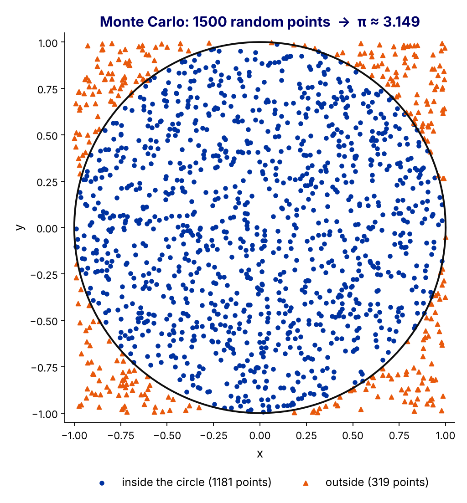

## The `random` library

`random` is part of the **standard library**: it comes with Python, so you only need to import it. It generates (pseudo-)random numbers and makes random choices.

```{python}
import random

random.seed(42)  # fix the seed to get the same numbers every time

print(random.random())            # a float in [0, 1)
print(random.randint(1, 6))       # an integer from 1 to 6, both included
print(random.uniform(10, 20))     # a float between 10 and 20
print(random.choice(["red", "green", "blue"]))   # one element of a list
```

More functions:

```{python}
cards = ["A", "K", "Q", "J", "10"]

random.shuffle(cards)             # shuffles the list in place
print(cards)

print(random.sample(cards, 2))    # 2 different elements, without repetition
print(random.choices(cards, k=3)) # 3 elements, with repetition
```

::: {.callout-note}
## Seeds

Computers do not generate truly random numbers: they follow a formula that starts from a **seed**. If you set the same seed, you get the same sequence. This is very useful to make experiments reproducible and to debug.

`random` and `numpy.random` are different generators. You have used `np.random` before, and `random.seed` does not affect it (and the other way around).
:::

::: {.callout-note}
## Related material

In Module 3 you generated random numbers and ran simulations with NumPy ([Random Numbers and Fancy Indexing](../numpy/random_fancy_indexing.qmd) and [Statistics and Simulation](../numpy/statistics.qmd)). Here we use the **standard library** instead: it needs no installation and works well for simple simulations with a few values at a time. NumPy is faster when you need millions of numbers at once.
:::

## Simulating random events

We can simulate an event by repeating it many times. For example, rolling two dice and adding the results:

```{python}
random.seed(1)

def roll_two_dice():
    return random.randint(1, 6) + random.randint(1, 6)

rolls = [roll_two_dice() for _ in range(10)]
print(rolls)
```

What is the probability of getting a 7? We can **estimate** it by counting how often it appears in many rolls:

```{python}
random.seed(1)

n = 100_000
sevens = sum(1 for _ in range(n) if roll_two_dice() == 7)
print(sevens / n)
```

The exact value is $6/36 \approx 0.1667$. The more repetitions, the closer the estimate gets (the *law of large numbers*).

## Monte Carlo experiments

{fig-alt="The ornate facade of the Casino de Monte-Carlo in Monaco, with three tall arched windows and colourful tile decoration." width="60%" fig-align="center"}

A **Monte Carlo experiment** uses random numbers to estimate a quantity that is difficult to compute exactly. The recipe is always the same:


1. Define the random experiment.
2. Repeat it a large number of times.
3. Compute the result from the frequencies (or the average) of the outcomes.

### Example: estimating $\pi$

Imagine a square with side 2 centred at the origin, and the circle of radius 1 inside it.

- The area of the square is $4$.
- The area of the circle is $\pi$.

If we throw random points into the square, the fraction that falls **inside the circle** is $\pi / 4$. So:

$$\pi \approx 4 \cdot \frac{\text{points inside the circle}}{\text{total points}}$$

A point $(x, y)$ is inside the circle when $x^2 + y^2 \le 1$.

{fig-alt="A square from minus 1 to 1 on both axes with a circle of radius 1 drawn inside. About 1,500 random points are scattered: blue dots inside the circle and orange triangles in the corners outside it. The fraction inside the circle gives an estimate of pi of about 3.15." width="55%" fig-align="center"}

```{python}
random.seed(1)

def estimate_pi(n):
    inside = 0
    for _ in range(n):
        x = random.uniform(-1, 1)
        y = random.uniform(-1, 1)
        if x**2 + y**2 <= 1:
            inside += 1
    return 4 * inside / n

for n in [100, 10_000, 1_000_000]:
    print(n, estimate_pi(n))
```

The estimate improves as `n` grows.

## Practice

::: {.callout-note}
## Exercise: Guessing Game

If you have not done it yet, write the [Guessing Game](review_general.qmd#ex-guessing-game) using `random.randint`.
:::

::: {.callout-tip collapse="true"}
## Solution

```python
import random

number = random.randint(1, 9)   # both ends are included
guesses = 0

while True:
    guess = input("Guess a number between 1 and 9, or type 'exit': ")
    if guess.lower() == "exit":
        break
    guess = int(guess)
    guesses += 1
    if guess < number:
        print("Too low!")
    elif guess > number:
        print("Too high!")
    else:
        print("Exactly right!")
        break

print(f"Game over. You took {guesses} guesses.")
```

Unlike `np.random.randint`, the function `random.randint` includes the upper limit. The same game written as a script with a `main` function is in [Writing and Running Scripts](scripts.qmd).
:::

::: {.callout-note}
## Exercise: The birthday problem

In a group of 23 people, what is the probability that at least two of them have the same birthday? Estimate it with a Monte Carlo experiment. Assume 365 equally likely days.

*Hint*: in each experiment, generate 23 random birthdays with `random.randint(1, 365)` and check whether there are repeated values. A `set` helps.
:::

::: {.callout-tip collapse="true"}
## Solution

```{python}
random.seed(1)

def has_shared_birthday(people=23):
    birthdays = [random.randint(1, 365) for _ in range(people)]
    return len(set(birthdays)) < people

n = 100_000
shared = sum(1 for _ in range(n) if has_shared_birthday())
print(shared / n)
```

The result is close to $0.51$: it is more likely than not that two people share a birthday.
:::

::: {.callout-note}
## Exercise: Dice

Estimate with a simulation the probability that the sum of three dice is at least 15. Try with 1,000 and with 1,000,000 repetitions. What do you notice?
:::

::: {.callout-tip collapse="true"}
## Solution

```{python}
random.seed(3)

def three_dice_at_least_15():
    return sum(random.randint(1, 6) for _ in range(3)) >= 15

for n in [1_000, 1_000_000]:
    count = sum(1 for _ in range(n) if three_dice_at_least_15())
    print(n, count / n)
```

The exact probability is $20/216 \approx 0.0926$: of the $6^3 = 216$ equally likely outcomes, 20 have a sum of 15 or more (10 with sum 15, 6 with 16, 3 with 17 and 1 with 18).

With 1,000 repetitions the estimate can easily be off by one or two hundredths, and it changes a lot from one seed to another. With 1,000,000 repetitions it is very close to $0.0926$. The more repetitions, the smaller the error: this is the law of large numbers.
:::

---

# Need Help?

If you have any questions, feel free to reach out via email at [dprecioso@faculty.ie.edu](mailto:dprecioso@faculty.ie.edu)

[Next: Environments](environments.qmd){.btn .btn-primary}
