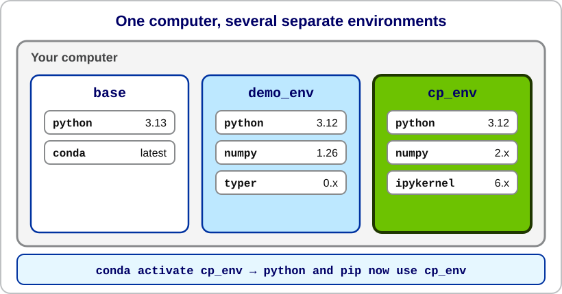

## What is an environment?

An **environment** is a separate space that keeps its own Python version and its own set of installed libraries.

Imagine two projects:

- Project A was written for NumPy 1.26.
- Project B needs NumPy 2.x.

If both shared one installation, installing one version would break the other project. With environments, each project has its own copy of the libraries and they never interfere.

Environments are useful because they:

- **isolate** the dependencies of each project, avoiding conflicts;
- make your project **reproducible**: someone else can create the same environment and get the same results;
- keep your computer clean: if an environment breaks, you delete it and create a new one.

{fig-alt="Diagram of one computer with three conda environments: base, demo_env with NumPy 1.26, and cp_env with NumPy 2. Running conda activate cp_env makes python and pip use cp_env." width="90%" fig-align="center"}

## Creating an environment

We use **conda**, which came with Anaconda.

1. Open a terminal:
   - **Windows:** open **Anaconda Prompt** from the Start menu.
   - **macOS and Linux:** open your normal terminal.
2. Create the environment with `conda create`. The `-n` flag gives it a name. Let's create `demo_env` with Python 3.12:

```bash
conda create -n demo_env python=3.12
```

Conda lists the packages it will install and asks `Proceed ([y]/n)?`. Type `y` and press `Enter`.

::: {.callout-note}
## Terms of Service prompt

The first time you run a command such as `conda create` or `conda install`, conda may ask you to accept Anaconda's **Terms of Service** for its default channels (`Do you accept the Terms of Service (ToS) for ...? [(a)ccept/(r)eject/(v)iew]`). Read them, type `a` to accept, and the command continues. You can also run `conda tos accept` in advance. If you reject, conda cannot install from those channels.
:::

## Activating the environment

Before using an environment you must **activate** it. This makes `python` and `pip` point to that environment:

```bash
conda activate demo_env
```

The name `(demo_env)` appears at the start of your prompt. To go back to the default environment:

```bash
conda deactivate
```

Other useful commands:

```bash
conda env list                    # list all your environments
conda list                        # list the libraries in the active environment
conda remove -n demo_env --all    # delete an environment
```

## Installing libraries in the environment

With the environment **active**, install the libraries you need:

```bash
conda install numpy
```

You can check what is installed with `conda list`. Anaconda also offers the community channel *conda-forge*, with many more packages: `conda install -c conda-forge package_name`. If a library is not available in conda, use pip *inside the active environment*:

```bash
pip install typer
```

::: {.callout-warning}
## Always check which environment is active

A very common mistake is to install a library in one environment and then run your code in another. If you get `ModuleNotFoundError` for a library you *know* you installed, check the environment name in your prompt and the interpreter selected in VS Code.
:::

## Using the environment in VS Code

VS Code can also create environments for you: run **Python: Create Environment** from the Command Palette and choose `venv` or `conda`. In this course we create them from the terminal, to understand what is happening.

### In a script

1. Open a `.py` file.
2. Look at the **bottom-right corner** of VS Code: it shows the Python interpreter. Click it.
3. Choose the one that says `demo_env`. If it does not appear, press `Ctrl` + `Shift` + `P` (`Cmd` + `Shift` + `P` on macOS), run **Python: Select Interpreter** and pick it (you may need to choose **Refresh**).

### In a notebook

1. Open the `.ipynb` file.
2. Click **Select Kernel** at the top right and choose **Python Environments**, then `demo_env`.
3. The notebook needs the `ipykernel` package in that environment. Install it with the environment active:

```bash
conda install ipykernel
```

Now the notebook uses the libraries of `demo_env`.

## Sharing an environment

To let somebody else recreate your environment, list its libraries in a file called `requirements.txt`:

```bash
pip freeze > requirements.txt
```

The other person creates and activates a new environment and runs:

```bash
pip install -r requirements.txt
```

A `requirements.txt` file has one library per line. You can ask for a specific version, or the latest one:

```text
numpy>=2,<3
typer
```

## Practice

::: {.callout-note}
## Exercise: Your own environment

1. Create an environment called `cp_env` with Python 3.12.
2. Activate it and install `numpy` and `ipykernel`.
3. Create a notebook in VS Code and select `cp_env` as the kernel.
4. In the first cell run:

```python
import numpy as np
print(np.__version__)
```

5. Open a terminal, run `conda deactivate`, and then run `conda env list`. Which environment has an asterisk `*`?
:::

::: {.callout-tip collapse="true"}
## Solution

```bash
conda create -n cp_env python=3.12
conda activate cp_env
conda install numpy ipykernel
```

After `conda deactivate`, the asterisk appears next to `base`: it is the environment active by default. While `cp_env` is active, the asterisk is next to `cp_env`.
:::

---

# Need Help?

If you have any questions, feel free to reach out via email at [dprecioso@faculty.ie.edu](mailto:dprecioso@faculty.ie.edu)

[Next: Creating your own library](own_library.qmd){.btn .btn-primary}
