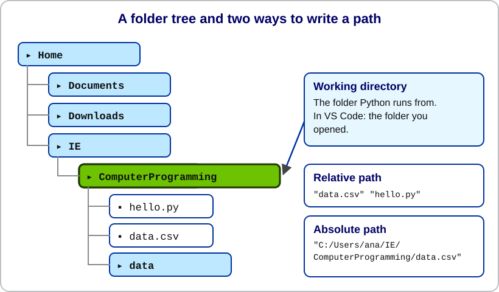
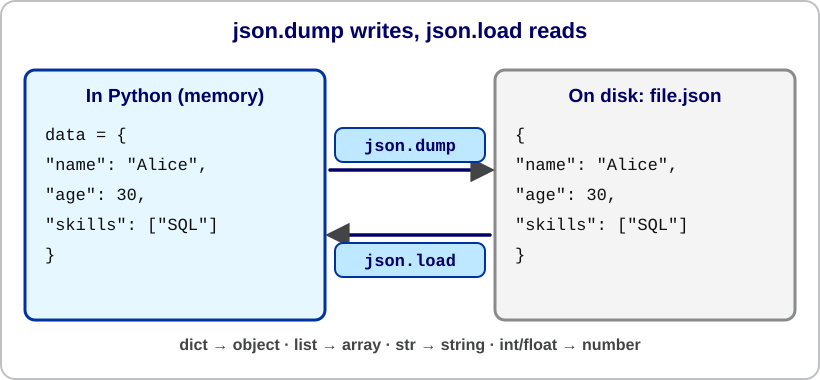

## Directories

A **directory** (or *folder*) is like a drawer in a filing cabinet: it contains files and other directories (*subdirectories*). This creates a hierarchy that starts at a **root** directory:

```text
Home
├── Documents
├── IE
│   └── ComputerProgramming
│       ├── hello.py
│       └── data.csv
└── Downloads
```

Python needs to know **where** a file is, so it is important to understand how your operating system organises directories.

{fig-alt="An open wooden drawer of a library card catalogue, full of index cards, next to many closed labelled drawers." width="60%" fig-align="center"}

::: {.panel-tabset}

### Windows

- The main drive is usually `C:\`. Each drive has its own letter.
- Paths use a **backslash** `\`, for example `C:\Users\maria\Documents`.
- Common folders: `C:\Program Files\` (applications), `C:\Users\` (one personal folder per user), `C:\Windows\` (system files).
- **File Explorer** is the program to browse files. Use the navigation panel on the left and the address bar at the top, where you can type a path.

### macOS

- There is a single root directory `/`.
- Paths use a **forward slash** `/`, for example `/Users/maria/Documents`.
- Common folders: `/Applications` (applications), `/Users` (home folders), `/System` and `/Library` (system files), and `~/Library` (your personal library inside your home folder).
- **Finder** is the program to browse files. Use the sidebar, the **Go** menu or Spotlight.

### Linux

- There is a single root directory `/`, as in macOS.
- Paths use a **forward slash** `/`, for example `/home/maria/Documents`.
- Common folders: `/home` (home folders), `/usr` (programs), `/etc` (configuration).
- Use your file manager, or the terminal.

:::

::: {.callout-tip}
## Writing paths in Python

Python understands forward slashes `/` on every operating system, including Windows. If you need a backslash in a Windows path, write it twice (`"C:\\Users\\maria"`) or use a raw string (`r"C:\Users\maria"`). A single `\` is an escape character in Python strings.
:::

## Common operations

| Action | Windows | macOS |
|---|---|---|
| New folder | Right-click > **New** > **Folder** | `Cmd` + `Shift` + `N`, or right-click > **New Folder** |
| Rename | Click the name, or right-click > **Rename** | Click the name, or right-click > **Rename** |
| Copy and paste | `Ctrl` + `C`, `Ctrl` + `V` | `Cmd` + `C`, `Cmd` + `V` |
| Move | Drag and drop | Drag and drop |
| Delete | `Delete` key (sends to Recycle Bin) | `Cmd` + `Delete` (sends to Trash) |

## Moving around in the terminal

You can do the same from the terminal. These commands exist in the VS Code terminal:

| What it does | Windows (PowerShell) | macOS / Linux |
|---|---|---|
| Show the current folder | `pwd` | `pwd` |
| List the files | `ls` (or `dir`) | `ls` |
| Go into a folder | `cd folder_name` | `cd folder_name` |
| Go to the parent folder | `cd ..` | `cd ..` |

## The working directory

When you run Python, it has a **working directory**: the folder it is running from. If you give Python a **relative path** such as `"data.csv"`, it looks for the file in that folder. You can check it:

```python
import os

print(os.getcwd())
```

In VS Code, the working directory is normally the folder that you opened with **File** > **Open Folder...**. The easiest way to avoid errors is to **put the files you need inside that folder**.

| Type of path | Example | Meaning |
|---|---|---|
| Relative | `data.csv` | A file in the working directory |
| Relative | `data/weather.json` | A file in the subfolder `data` |
| Absolute | `C:/Users/maria/data.csv` | The full path from the root of the drive |

If you see `FileNotFoundError`, the file is not where Python is looking. Check the working directory and the spelling of the file name.

{fig-alt="A folder tree with Home, Documents, Downloads and IE. Inside IE is ComputerProgramming, highlighted as the working directory, containing hello.py, data.csv and a folder called data. Side notes explain relative and absolute paths." width="90%" fig-align="center"}

## Reading and writing files with NumPy

You already know how to load numeric tables with NumPy (see [Loading and Saving Data](../numpy/load.qmd)). The file must be in the working directory:

```python
import numpy as np

# Read a CSV file into an array
data = np.loadtxt("data.csv", delimiter=",")

# Write an array to a CSV file
array = np.array([[1, 2, 3], [4, 5, 6]])
np.savetxt("array.csv", array, delimiter=",")
```

NumPy is perfect for tables of numbers. But how do we store other kinds of data, such as a dictionary? For that we need plain files and the `open()` function.

## Text files with `open()`

`open(path, mode)` opens a file. The **mode** says what we want to do:

| Mode | Meaning |
|---|---|
| `"r"` | **Read** (the default). The file must exist. |
| `"w"` | **Write**. Creates the file, or **erases** it if it exists. |
| `"a"` | **Append**. Adds text at the end of the file. |

Always use `open` inside a `with` block. It closes the file for you, even if there is an error:

```python
# Write a text file
with open("notes.txt", "w") as file:
    file.write("First line\n")
    file.write("Second line\n")

# Read the whole file as one string
with open("notes.txt", "r") as file:
    content = file.read()
print(content)

# Read it line by line
with open("notes.txt", "r") as file:
    for line in file:
        print(line.strip())
```

`\n` is the character that marks the end of a line, and `strip()` removes it (and spaces) from the ends of a string.

## JSON files

**JSON** (JavaScript Object Notation) is a text format to store data structures. It looks very much like Python dictionaries and lists, and it is used everywhere: web services, configuration files, datasets.

```json
{
  "employees": [
    {"name": "Alice", "age": 30},
    {"name": "Bob", "age": 25}
  ]
}
```

Python's standard library has a module for it: `json`.


| Python | JSON |
|---|---|
| `dict` | object `{...}` |
| `list`, `tuple` | array `[...]` |
| `str` | string |
| `int`, `float` | number |
| `True`, `False`, `None` | `true`, `false`, `null` |

{fig-alt="Diagram: a Python dictionary in memory is written to a file called file.json with json.dump, and read back into a dictionary with json.load." width="85%" fig-align="center"}

### Reading JSON

```python
import json

with open("file.json", "r") as file:
    data = json.load(file)

print(data)
```

`json.load` reads the file and returns the data as Python dictionaries and lists. The `"r"` means "read".

### Writing JSON

```python
import json

data = {"key": "value", "numbers": [1, 2, 3]}

with open("file.json", "w") as file:
    json.dump(data, file, indent=2)
```

`json.dump` writes the data to the file. The `"w"` means "write", and `indent=2` makes the file easy to read.

::: {.callout-warning}
## Careful with `"w"`

Opening an existing file in `"w"` mode **deletes its previous content**. To avoid losing data, write the result to a **new** file name, as in the next exercise.
:::

## Practice

::: {.callout-note}
## Exercise: JSON Data Manager

1. Create a file `employees.json` with the content shown above.
2. Write a script `json_manager.py` that:
   - reads `employees.json` and loads it into a Python dictionary,
   - adds a new employee to the `"employees"` list,
   - writes the updated data to `employees_updated.json`.
3. Run the script and open the new file to check that the new employee is there.
:::

::: {.callout-tip collapse="true"}
## Solution

```python
import json


def main():
    with open("employees.json", "r") as file:
        data = json.load(file)

    data["employees"].append({"name": "Carla", "age": 28})

    with open("employees_updated.json", "w") as file:
        json.dump(data, file, indent=2)


if __name__ == "__main__":
    main()
```
:::

::: {.callout-note}
## Exercise: Weather Data Analysis

Create a file `weather.json` like this one (you can add more days):

```json
{
  "city": "Madrid",
  "days": [
    {"date": "2026-11-02", "temperature": 14.5, "humidity": 62},
    {"date": "2026-11-03", "temperature": 17.0, "humidity": 55},
    {"date": "2026-11-04", "temperature": 21.3, "humidity": 48},
    {"date": "2026-11-05", "temperature": 22.8, "humidity": 40},
    {"date": "2026-11-06", "temperature": 12.1, "humidity": 71}
  ]
}
```

Write a script `weather_analysis.py` that:

1. Reads `weather.json` and loads the temperatures and humidities into NumPy arrays.
2. Computes the average, maximum and minimum temperature, and the average humidity.
3. Finds the days with a temperature above a threshold (for example 20 °C).
4. Stores these statistics in a dictionary and writes them to `weather_statistics.json`.
:::

::: {.callout-tip collapse="true"}
## Solution

```python
import json

import numpy as np

THRESHOLD = 20


def main():
    with open("weather.json", "r") as file:
        data = json.load(file)

    dates = [day["date"] for day in data["days"]]
    temperature = np.array([day["temperature"] for day in data["days"]])
    humidity = np.array([day["humidity"] for day in data["days"]])

    hot_days = [dates[i] for i in np.where(temperature > THRESHOLD)[0]]

    statistics = {
        "average_temperature": float(np.mean(temperature)),
        "max_temperature": float(np.max(temperature)),
        "min_temperature": float(np.min(temperature)),
        "average_humidity": float(np.mean(humidity)),
        "days_above_threshold": hot_days,
    }

    with open("weather_statistics.json", "w") as file:
        json.dump(statistics, file, indent=2)


if __name__ == "__main__":
    main()
```

We convert the NumPy numbers with `float(...)` because `json` cannot write NumPy number types directly. With the data above, the average temperature is `17.54` and the days above 20 °C are `2026-11-04` and `2026-11-05`.
:::

---

# Need Help?

If you have any questions, feel free to reach out via email at [dprecioso@faculty.ie.edu](mailto:dprecioso@faculty.ie.edu)
