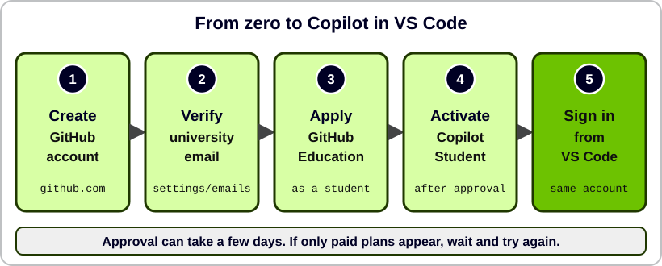

## What is GitHub Copilot?

{.m4-logo height="64px"}

**GitHub Copilot** is an AI assistant that works inside VS Code. It can suggest code while you type, answer questions about your code in a chat panel, and explain error messages. Verified students can use it for free through **GitHub Education**, with the **GitHub Copilot Student** plan.

::: {.callout-important}
## Use it to learn, not to skip the learning

Copilot can write code that you do not understand, and what matters is that **you** can explain and modify your code. Use it to ask for explanations, to understand an error message, or to check your idea after you have tried it yourself. Follow the instructions of each activity about when AI tools are allowed. In some in-class practice your instructor may ask you to switch it off (see the end of this page).
:::

## Which route gives me Copilot?

There are two names that are easy to confuse:

| Service | Who uses it | Does it give me Copilot? |
|---|---|---|
| **GitHub Education** (student benefits) | Students | **Yes.** Once your student status is verified you can activate **Copilot Student**. |
| **GitHub Classroom** | Teachers, to distribute and collect assignments | **No.** It is only a teaching tool, and GitHub announced that it would be retired on 28 August 2026, so it may no longer be available. Even if an instructor shared a Classroom assignment link with you, accepting it would not activate Copilot. |

So the process is: create a GitHub account, add and verify your university email, apply to GitHub Education, then activate Copilot.

::: {.callout-note}
## What the Student plan includes

Since March 2026, verified students are on the **Copilot Student** plan. Compared with the paid plans it has some limits: for example, the model is chosen **automatically** (you cannot pick a specific one), some advanced agent features are not included, and monthly usage allowances apply. The exact limits change over time, so check the [plans comparison](https://docs.github.com/en/copilot/get-started/plans) and the [GitHub announcement](https://github.blog/changelog/2026-03-13-updates-to-github-copilot-for-students/).
:::

::: {.callout-note}
GitHub reviews the conditions of student offers from time to time, and it re-checks your eligibility every month. If a step below looks different on your screen, follow the current instructions in the [GitHub Docs](https://docs.github.com/en/copilot/how-tos/copilot-on-github/set-up-copilot/enable-copilot/set-up-for-students).
:::

## Requirements

- You are currently enrolled in a degree-granting programme (IE University counts).
- You have a **personal** GitHub account. Do not use an account shared with others.
- You are at least 13 years old (I guess you are!).
- You can access your **IE University student email**, because GitHub may send a verification message to it.

::: {.callout-warning}
## Protect your personal data

Only upload the proof of enrolment that GitHub asks for, and cover any information that is not needed (for example, ID numbers). Never share your password or verification codes with anyone, and do not post screenshots of your documents on forums or in group chats.
:::

## Step by step

{fig-alt="Five numbered steps from left to right: create a GitHub account, verify your university email, apply to GitHub Education, activate Copilot Student, and sign in from VS Code." width="95%" fig-align="center"}

::: {.callout-tip}
Use a computer for this process. Allow about 15 minutes, plus waiting time for GitHub to review your application.
:::

### 1. Create a GitHub account

1. Go to [github.com](https://github.com) and click **Sign up**.
2. Choose a professional username (for example, based on your name). Future employers may see it.
3. Use a strong password and turn on two-factor authentication under **Settings** > **Password and authentication**.

If you already have an account, keep using it.

### 2. Add and verify your university email

1. Open [github.com/settings/emails](https://github.com/settings/emails).
2. Under **Add email address**, type your IE University student email and click **Add**.
3. GitHub sends a message to that address. Open it and click the verification link.
4. Check that the email now shows as **Verified**.

You can keep another email as your primary address. The university address only has to be added and verified.

### 3. Apply to GitHub Education

1. Open [github.com/settings/education/benefits](https://github.com/settings/education/benefits).
2. Under **GitHub Education**, click **Start an application** (this is the same as joining *GitHub Global Campus* from [education.github.com](https://education.github.com)). Select **Student** if you are asked.
3. Check that your school email is selected and that your name matches your enrolment record.
4. If GitHub asks for **proof of academic status**, upload one of these: a photo of your university ID showing the current enrolment period, your class schedule, your transcript, or an enrolment certificate. The document must be current and readable, and your name must be visible.
5. If GitHub asks to share your location, allow it in the browser. Applications can fail if GitHub cannot match your location with your school.
6. Click **Submit application**.

### 4. Wait for the decision

You will see the status on the same page and receive an email. Many applications are approved automatically within minutes, others take several days. Do not submit repeated applications while one is pending. If you are rejected, read the reason shown, correct it (for example, a clearer document or a verified university email), and apply again.

### 5. Activate Copilot Student

Approval and Copilot activation are two different steps, and the benefit can take a few days to appear after approval.

1. Go back to [github.com/settings/education/benefits](https://github.com/settings/education/benefits).
2. Under **Free GitHub developer resources for students and teachers**, click **Learn more**.
3. Follow the prompts to activate **Copilot Student** and set your Copilot policies.
4. You can also go to [github.com/settings/copilot](https://github.com/settings/copilot) to check your status.

::: {.callout-warning}
If the page only offers **paid** plans, do not buy anything. Wait a few days and try again. If it still does not appear, contact GitHub Support.
:::

## Use Copilot in VS Code

1. Open VS Code (see [Installing VS Code](vscode_install.qmd)). Recent versions include Copilot. If you do not see it, update VS Code (**Help** > **Check for Updates**) or install the **GitHub Copilot** and **GitHub Copilot Chat** extensions.
2. Open the Chat view: press `Ctrl` + `Alt` + `I` (`Ctrl` + `Cmd` + `I` on macOS), or click the chat icon at the top of the window.
3. If you are asked to sign in, click **Sign in with GitHub**, then authorise VS Code in the browser window that opens. Use the **same GitHub account** that has Copilot Student.
4. Type a question. For example: *"Explain what this error means and give me a hint, not the full solution."*

Good habits:

- Try the problem yourself first. Then ask Copilot for a **hint**.
- Ask it to **explain** code instead of just writing it.
- Always **read and run** what it proposes. It can be wrong, and you are responsible for the code you submit.
- Do not paste personal data, passwords or API keys into the chat.

### Turn Copilot off when you need to

- Click the **Copilot** icon in the status bar (bottom right) and choose to disable inline suggestions, either for all files or for the current language.
- Or open the Command Palette (`Ctrl` + `Shift` + `P`, `Cmd` + `Shift` + `P` on macOS) and search for **Copilot** to see the available options.

## Troubleshooting

| Problem | What to try |
|---|---|
| GitHub does not accept my university email | Check that you added it at [github.com/settings/emails](https://github.com/settings/emails) and clicked the verification link. If the domain is not recognised, contact GitHub Education Support with your school name, website and email domain. |
| Application rejected | Read the reason. Upload a clearer, current document with your name visible, and make sure your GitHub profile name matches it. |
| Approved, but no Copilot option | Wait a few days. Then try [github.com/settings/copilot](https://github.com/settings/copilot) or [github.com/github-copilot/free_signup](https://github.com/github-copilot/free_signup). |
| VS Code does not show Copilot | Update VS Code, then sign in again from the **Accounts** icon in the left bar. |
| Access disappeared | GitHub re-checks eligibility every month. Re-verify your student status in the Education benefits page. |

---

# Need Help?

If you have any questions, feel free to reach out via email at [dprecioso@faculty.ie.edu](mailto:dprecioso@faculty.ie.edu)
