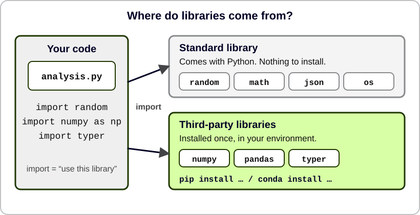

## What is a library?

A **library** is a collection of ready-made modules and functions that you can use in your own programs. You have already used one: `numpy`. Libraries save time, because you do not have to write (and test) everything yourself.

| Kind | Where it comes from | Examples |
|---|---|---|
| **Standard library** | Installed together with Python | `random`, `math`, `json`, `os` |
| **Third-party library** | Downloaded and installed by you | `numpy`, `pandas`, `matplotlib`, `typer` |

There are libraries for almost everything: numerical computing (NumPy), data analysis (pandas), plots (matplotlib), web development (Django, Flask) or machine learning (TensorFlow, PyTorch).

{fig-alt="Wooden bookshelves full of books in a public library." width="60%" fig-align="center"}

{fig-alt="Diagram: a script called analysis.py imports libraries. The standard library comes with Python. Third-party libraries such as numpy, pandas and typer are installed with pip install or conda install." width="90%" fig-align="center"}

## Importing a library

To use a library you must **import** it first. These are the usual forms:

```{python}
import math                      # use as math.sqrt(...)
from math import sqrt, pi        # use directly as sqrt(...)
import numpy as np               # use a short alias: np.array(...)

print(math.sqrt(16))
print(sqrt(16), pi)
print(np.array([1, 2, 3]))
```

::: {.callout-tip}
## Good practice

Put all your `import` lines at the top of the file. Use the standard aliases that everyone knows (`np` for NumPy), so other people can read your code easily.
:::

If you import a library that is not installed, Python raises an error:

```python
import typer
# ModuleNotFoundError: No module named 'typer'
```

That means we must install it first.

## Installing libraries with pip

**pip** is Python's package installer. It downloads libraries from the *Python Package Index* (PyPI) and installs them. You run it in a **terminal** (in VS Code: **Terminal** > **New Terminal**):

```bash
pip install numpy
```

Other useful commands:

```bash
pip list                  # show installed libraries
pip install numpy==2.3.0   # install a specific version
pip uninstall numpy       # remove a library
```

::: {.callout-warning}
## "externally-managed-environment"

On some Linux and macOS systems, `pip install` fails with the message `error: externally-managed-environment`. It means you are trying to install into the Python that belongs to the operating system, which is protected. **Do not force it.** Activate a conda environment first (see [Environments](environments.qmd)) and install there.
:::

::: {.callout-note}
## Pip in a notebook

In a notebook (Colab or VS Code) you can run terminal commands from a cell by writing `!` or `%` in front, for example `%pip install numpy`. In VS Code, we prefer to install libraries from the terminal, with the right environment active (see [Environments](environments.qmd)).
:::

## Installing libraries with conda

**conda** is the package and environment manager that comes with Anaconda. It installs libraries too:

```bash
conda install numpy
```

### pip or conda?

| | pip | conda |
|---|---|---|
| Installs | Python packages | Packages in any language, including Python itself |
| Source | PyPI | Anaconda channels (and conda-forge) |
| Environments | Needs another tool (`venv`) | Built in |
| Typical use | Pure Python libraries | Data science libraries with non-Python dependencies |

A simple rule for this course: **try `conda install` first**. If the package is not found, use `pip install` *inside the same conda environment*.

## Practice

Try these exercises in a notebook or a script in VS Code. Remember to read the error messages: they tell you what is wrong.

- [Card Dealer](review_general.qmd#ex-card-dealer): uses `random` and `numpy`.
- [Log-Sum-Exp Function](review_general.qmd#ex-log-sum-exp): uses NumPy functions.
- [NumPy Difference](review_general.qmd#ex-numpy-difference): uses `np.diff` and `np.concatenate`.
- [Remove Duplicates](review_general.qmd#ex-remove-duplicates) and [Invert Dictionary](review_general.qmd#ex-invert-dictionary): warm-up exercises with strings and dictionaries.

::: {.callout-note}
## Exercise

1. Open a terminal in VS Code and install `matplotlib` with `conda install matplotlib` (or `pip install matplotlib`).
2. In a notebook, run `import matplotlib.pyplot as plt` and check that no error appears.
3. Run `pip list` (or `conda list`) and find the version of NumPy you have installed.
:::

::: {.callout-tip collapse="true"}
## Solution

1. In the VS Code terminal (with your environment active):

```bash
conda install matplotlib
```

Type `y` when conda asks to proceed. If conda cannot find the package, use `pip install matplotlib` instead.

2. In a notebook cell:

```python
import matplotlib.pyplot as plt
print(plt.matplotlib.__version__)
```

If it prints a version number and there is no error, the library is installed in the environment that the notebook uses. If you see `ModuleNotFoundError`, you installed it in a different environment: check the kernel at the top right of the notebook.

3. In the terminal, `conda list numpy` or `pip list` shows a line such as `numpy   2.x.x`. You can also check it from Python:

```python
import numpy as np
print(np.__version__)
```
:::

---

# Need Help?

If you have any questions, feel free to reach out via email at [dprecioso@faculty.ie.edu](mailto:dprecioso@faculty.ie.edu)
