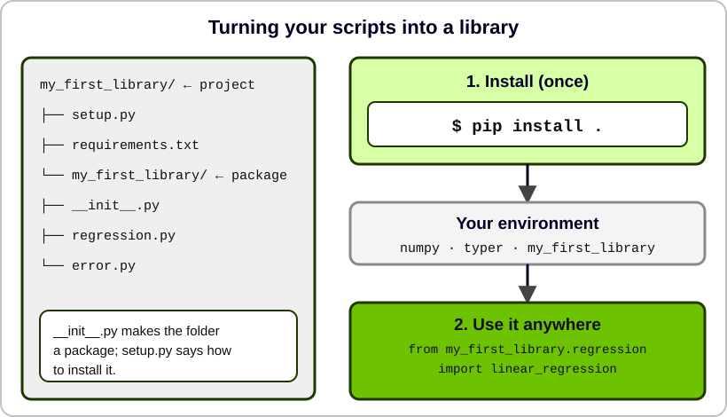

## From a script to a library

In this section we will build a small library, step by step, and install it in our environment, just like NumPy or matplotlib.

Our running example is **linear regression**. You met it in the [General Review](review_linear_regression.qmd): given $N$ points $(x_i, y_i)$, we look for the line

$$y_i = b_0 + b_1 \cdot x_i$$

that fits them as well as possible. In matrix notation $\mathbf{Y} = X \cdot \mathbf{b}$, where

$$
X = \begin{pmatrix} 1 & x_1 \\ \vdots & \vdots \\ 1 & x_N \end{pmatrix},
\qquad
\mathbf{b} = \begin{pmatrix} b_0 \\ b_1 \end{pmatrix}
$$

With the **Ordinary Least Squares** method we get $\mathbf{b}$ from the Normal Equation:

$$\mathbf{b} = \left(X^T \cdot X\right)^{-1} \cdot X^T \cdot \mathbf{Y}$$

## Step 1: the project folder and the first module

1. Make sure your environment (for example `demo_env`) has NumPy installed.
2. Create a folder called `my_first_library` and open its **parent** folder in VS Code.
3. Inside it, create a script `regression.py`.

```python
import numpy as np


def linear_regression(x, y):
    """Fit y = b0 + b1 * x with the Normal Equation and return b."""
    x = np.asarray(x, dtype=float)
    y = np.asarray(y, dtype=float)
    X = np.column_stack([np.ones(len(x)), x])
    return np.linalg.inv(X.T @ X) @ X.T @ y


def main(points_file, output_file):
    """Read the points from a text file and save the coefficients b."""
    x, y = np.loadtxt(points_file, unpack=True)
    b = linear_regression(x, y)
    np.savetxt(output_file, b)
    print(f"b0 = {b[0]:.4f}, b1 = {b[1]:.4f}")


if __name__ == "__main__":
    main("data_array.txt", "b.txt")
```

The input file `data_array.txt` has one point per row, with `x` and `y` separated by a space:

```text
1.0 2.1
2.0 3.9
3.0 6.2
4.0 7.8
```

::: {.callout-warning}
## Where is the file?

Python looks for `data_array.txt` in the **working directory**, which is normally the folder open in VS Code. Put the data file in that folder, or give a path to it (see [Files and Directories](files.qmd)).
:::

::: {.callout-note}
## Exercise

Create `data_array.txt` with your own points, run `regression.py`, and check the file `b.txt`. Compare your result with the line that you get from the review exercise.
:::

## Step 2: make it a package

We want to import our code **from anywhere**, not only from the folder where the file is. First we turn the folder into a **package**.

Create an **empty file** named `__init__.py` inside `my_first_library`. This file tells Python that the folder is a package. It can be empty, or contain code that runs when the package is imported.

Each script inside the package is now a **module**. We can import our function with:

```python
from my_first_library.regression import linear_regression
```

You could already import scripts before. The difference is that, once the library is installed (step 4), it does not matter where the script is located.

Your folder should look like this:

```text
my_first_library/          <- project folder
├── my_first_library/      <- the package
│   ├── __init__.py
│   └── regression.py
├── setup.py
└── requirements.txt
```

Note that there are **two** folders with the same name: the outer one is the project, and the inner one is the package.


## Step 3: setup file and requirements

Outside the package folder (in the project folder), create `setup.py`. It tells **setuptools** how to build and install your library, and includes metadata such as the name, version or author:

```python
from setuptools import find_packages, setup

setup(
    name="my_first_library",
    version="0.1",
    packages=find_packages(),
    # More metadata: author, description, ...
)
```

If your library needs other packages, list them in `requirements.txt`, one per line. You can ask for the latest version or a specific one:

```text
numpy
typer
```

To make `pip` install these dependencies automatically, add them to `setup.py` too:

```python
setup(
    name="my_first_library",
    version="0.1",
    packages=find_packages(),
    install_requires=["numpy", "typer"],
)
```

::: {.callout-note}
## `setup.py` and `pyproject.toml`

`setup.py` is the classic way to describe a package and it is simple to understand, so we use it here. New projects often put the same information in a file called `pyproject.toml`, which is the current standard. The ideas (name, version, packages, dependencies) are the same.
:::

## Step 4: install your library

{fig-alt="Left: a project folder containing setup.py, requirements.txt and a package folder with __init__.py, regression.py and error.py. Right: pip install . installs the library into your environment, and then you can import it from anywhere." width="90%" fig-align="center"}

Open a terminal in the **project folder** (the one that contains `setup.py`), activate your environment and run:

```bash
pip install .
```

The dot means "the current folder". Now your library is installed in the environment. From **any** folder, script or notebook using that environment you can write:

```python
from my_first_library.regression import linear_regression

print(linear_regression([1, 2, 3, 4], [3, 5, 7, 9]))   # [1. 2.]
```

::: {.callout-tip}
## Editing your library

If you change the code of your library, install it again with `pip install .`. A more comfortable option while developing is `pip install -e .` (*editable* mode), which makes Python use your files directly, so changes apply immediately.
:::

## Step 5: command-line options with typer

Our `main` has the file names written in the code. How can the user choose a different file when running the script? The `typer` library (install it with pip) turns the arguments of a function into command-line options.

```python
import typer


def main(name: str = "Daniel"):
    print(f"Name is {name}")


if __name__ == "__main__":
    typer.run(main)
```

Save this as `demo.py` and run it:

```bash
python demo.py
# Name is Daniel

python demo.py --name Bella
# Name is Bella
```

Every parameter of `main` becomes an option (`--name`), and its **type hint** (`str`) tells typer how to convert it. Parameters with a default value are optional.

Let's use it in `regression.py`. Replace the last lines with:

```python
import typer


def main(points_file: str = "data_array.txt", output_file: str = "b.txt"):
    """Read the points from a text file and save the coefficients b."""
    x, y = np.loadtxt(points_file, unpack=True)
    b = linear_regression(x, y)
    np.savetxt(output_file, b)
    print(f"b0 = {b[0]:.4f}, b1 = {b[1]:.4f}")


if __name__ == "__main__":
    typer.run(main)
```

Now we can choose the files from the terminal (`--points-file` uses a hyphen):

```bash
python regression.py --points-file my_points.txt --output-file my_b.txt
```

## Step 6: add a new module

A library usually has several modules. Create `error.py` inside the package. It will measure how good the fit is, using two standard measures for points $y_i$ and predictions $\hat{y}_i$:

$$
L_1 = \frac{1}{N}\sum_i \left|y_i - \hat{y}_i\right|,
\qquad
L_2 = \sqrt{\frac{1}{N}\sum_i \left(y_i - \hat{y}_i\right)^2}
$$

::: {.callout-note}
## Exercise

Write `my_first_library/error.py` with:

- the functions `l1_error(y_true, y_pred)` and `l2_error(y_true, y_pred)`, which take NumPy arrays and return floats;
- a `main` function that takes two files, the array of points $(x, y)$ and the file with the coefficients $\mathbf{b}$, and prints the L1 and L2 errors.
:::

::: {.callout-tip collapse="true"}
## Solution

```python
import numpy as np
import typer


def l1_error(y_true, y_pred):
    """Mean absolute error."""
    return float(np.mean(np.abs(np.asarray(y_true) - np.asarray(y_pred))))


def l2_error(y_true, y_pred):
    """Root mean squared error."""
    return float(np.sqrt(np.mean((np.asarray(y_true) - np.asarray(y_pred)) ** 2)))


def main(points_file: str, coefficients_file: str):
    x, y = np.loadtxt(points_file, unpack=True)
    b = np.loadtxt(coefficients_file)
    y_pred = b[0] + b[1] * x
    print(f"L1 error: {l1_error(y, y_pred):.4f}")
    print(f"L2 error: {l2_error(y, y_pred):.4f}")


if __name__ == "__main__":
    typer.run(main)
```

Run it with `python error.py data_array.txt b.txt`. Remember to reinstall the library (`pip install .`) after adding a module.
:::

## Step 7: use your library in a notebook

1. Open a new notebook and select your environment (`demo_env`) as the kernel.
2. Import NumPy, `linear_regression`, `l1_error` and `l2_error`.
3. Load `data_array.txt` into arrays `x` and `y`, fit the model and compute the L1 and L2 errors.

```python
import numpy as np

from my_first_library.regression import linear_regression
from my_first_library.error import l1_error, l2_error

x, y = np.loadtxt("data_array.txt", unpack=True)
b = linear_regression(x, y)
y_pred = b[0] + b[1] * x

print(b)
print(l1_error(y, y_pred), l2_error(y, y_pred))
```

## Challenges

::: {.callout-note}
## Challenge 1: Noisy data

In the same notebook, use NumPy to generate:

- `x1`: 100 random points in the interval $[0, 10]$.
- `x2`: 100 random points in the interval $[20, 40]$.
- $y = 3 + 4 x_1 - x_2$.
- Noisy values $y' = y + N(0, 2)$ (a normal distribution with mean 0 and standard deviation 2).

Fit $(x_1, x_2, y')$ with your regression and compute the L1 and L2 errors. What happens to the errors when you use 1,000,000 points instead of 100?

*Hint*: this needs a regression with several variables, see Challenge 2.
:::

::: {.callout-note}
## Challenge 2: Any number of dimensions

Extend `linear_regression` so that it accepts a matrix of inputs with any number of columns:

$$y_i = b_0 + b_1 x_{1,i} + b_2 x_{2,i} + \dots$$

*Hint*: build $X$ with a first column of ones followed by one column per variable, and use the same Normal Equation.
:::

::: {.callout-tip collapse="true"}
## Solution

```python
import numpy as np


def linear_regression(X_inputs, y):
    """Fit y = b0 + b1 * x1 + b2 * x2 + ... and return b.

    X_inputs has shape (N,) for one variable, or (N, k) for k variables.
    """
    X_inputs = np.asarray(X_inputs, dtype=float)
    if X_inputs.ndim == 1:
        X_inputs = X_inputs[:, None]
    X = np.column_stack([np.ones(len(X_inputs)), X_inputs])
    return np.linalg.solve(X.T @ X, X.T @ np.asarray(y, dtype=float))
```

Using `np.linalg.solve` instead of an explicit inverse is faster and numerically more stable, and gives the same result.

For Challenge 1:

```python
rng = np.random.default_rng(0)
n = 100
x1 = rng.uniform(0, 10, n)
x2 = rng.uniform(20, 40, n)
y = 3 + 4 * x1 - x2
y_noisy = y + rng.normal(0, 2, n)

b = linear_regression(np.column_stack([x1, x2]), y_noisy)
print(b)   # close to [3, 4, -1]
```

With more points the coefficients get closer to $(3, 4, -1)$, but the errors do not go to zero (L2 stays near 2 and L1 near 1.6): it is the noise that we added, and no model can remove it.
:::

---

# Need Help?

If you have any questions, feel free to reach out via email at [dprecioso@faculty.ie.edu](mailto:dprecioso@faculty.ie.edu)

[Back to Module 4](index.qmd){.btn .btn-secondary}
