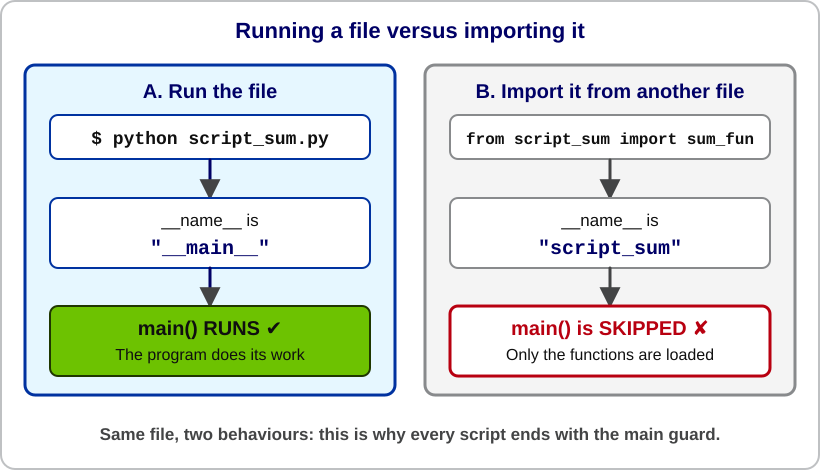

## Notebooks and scripts

A **Python script** is a text file with the extension `.py` that contains Python code. Compared with a notebook:

| | Notebook (`.ipynb`) | Script (`.py`) |
|---|---|---|
| Structure | Cells that you run one by one | One program that runs top to bottom |
| Output | Shown below each cell | Shown in the terminal |
| Best for | Exploring, learning, reports | Larger projects, automation, reusable code |
| Reusable from other files | Difficult | Yes, with `import` |

Notebooks are great for exploring. When your code grows, or you want to reuse it, move it to a script.

## Your first script

1. In VS Code, open your course folder (**File** > **Open Folder...**).
2. Create a new file named `hello.py`.
3. A script usually has three parts, in this order: **imports**, **functions**, **main code**.

```python
import numpy as np


def greet(name):
    """Return a greeting for the given name."""
    return f"Hello, {name}!"


name = "BAM"
print(greet(name))
print("Lucky number:", np.random.randint(1, 9))
```

4. Run it with the **Run Python File** button (the triangle at the top right), or in a terminal:

```bash
python hello.py
```

::: {.callout-note}
The terminal must be **in the same folder** as the file. In VS Code, the integrated terminal opens in the folder you have open.
:::

## Execution order

Python runs a script **from the first line to the last**. Functions are only *defined* when Python reads the `def`; their code runs only when you *call* them.

```python
print("1. start")

def say_hello():
    print("3. inside the function")

print("2. after the definition")
say_hello()
print("4. end")
```

The numbers show the order in which the messages appear.

## The `main` function

When we put a script in a file, we usually write the code that does the work inside a function called `main`, and we call it at the end:

```python
def compute_square(x):
    return x ** 2


def main():
    print(compute_square(7))


if __name__ == "__main__":
    main()
```

What does `if __name__ == "__main__":` mean?

- Python gives every file a special variable called `__name__`.
- If you **run** the file directly (`python script.py`), `__name__` is equal to `"__main__"`, so the code inside the `if` **runs**.
- If another file **imports** this one, `__name__` is the name of the file, so the code inside the `if` is **skipped**.

This lets the same file work as a program *and* as a collection of functions that other files can import.

{fig-alt="Two columns. Running python script_sum.py makes the name equal to __main__, so main runs. Importing script_sum from another file makes the name script_sum, so main is skipped and only the functions are loaded." width="90%" fig-align="center"}

## Getting input from the user

The `input()` function pauses the script and waits for the user to type text in the terminal. It always returns a **string**:

```python
text = input("Enter some numbers separated by spaces: ")
numbers = [float(x) for x in text.split()]
print(numbers)
```

Typing `2 4 4 4` gives `[2.0, 4.0, 4.0, 4.0]`. Here `split()` cuts the string at the spaces and `float()` converts each piece to a number.

## Importing functions from another script

You can reuse functions from one script in another. Suppose we have two files in the **same folder**:

```python
# script_sum.py
def sum_fun(a, b):
    return a + b


def main():
    print(sum_fun(2, 3))


if __name__ == "__main__":
    main()
```

```python
# script_calc.py
from script_sum import sum_fun


def diff_fun(a, b):
    return a - b


def main():
    print(sum_fun(10, 4))
    print(diff_fun(10, 4))


if __name__ == "__main__":
    main()
```

To import several functions from the same file:

```python
from script_sum import sum_fun, another_function
```

::: {.callout-warning}
## Important

- The script you import from must be in the **folder you are working in** (or in a folder Python can find).
- Do not include the `.py` in the import: write `from script_sum import sum_fun`, not `from script_sum.py import sum_fun`.
- Because of `if __name__ == "__main__":`, importing `script_sum` does **not** run its `main()`.
:::

## Practice

When something fails, read the error message first. If you need a reminder of debugging techniques, try the [Debugging Questions](review_general.qmd#debugging-questions).

::: {.callout-note}
## Exercise: Guessing Game

Do the [Guessing Game](review_general.qmd#ex-guessing-game) as a script `guessing_game.py`. Import the `numpy.random` submodule (or the `random` library) to generate the number. The game must end when the user guesses the number or types `exit`, and then print the number of guesses.
:::

::: {.callout-tip collapse="true"}
## Solution

Save this as `guessing_game.py` and run it with `python guessing_game.py`:

```python
import numpy as np


def guessing_game():
    number = np.random.randint(1, 9)   # both ends are included
    guesses = 0

    while True:
        guess = input("Guess a number between 1 and 9, or type 'exit': ")

        if guess.lower() == "exit":
            break

        guess = int(guess)
        guesses += 1

        if guess < number:
            print("Too low!")
        elif guess > number:
            print("Too high!")
        else:
            print("Exactly right!")
            break

    print(f"Game over. You took {guesses} guesses.")


def main():
    guessing_game()


if __name__ == "__main__":
    main()
```

`random.randint(a, b)` includes **both** limits, so `random.randint(1, 9)` can return 9. Compare with `np.random.randint(1, 10)`, where the upper limit is excluded. If the user types something that is not a number or `exit`, `int(guess)` raises a `ValueError`: you can handle it with `try` / `except ValueError`.
:::

::: {.callout-note}
## Exercise: Standard Deviation

Write a script `std.py` with two functions:

- `compute_std` calculates the standard deviation of a list of numbers.
- `main` asks the user to type some numbers separated by spaces, then computes and prints their standard deviation.

Use `input()` to read from the terminal.
:::

::: {.callout-tip collapse="true"}
## Solution

```python
import math


def compute_std(numbers):
    """Return the (population) standard deviation of a list of numbers."""
    n = len(numbers)
    mean = sum(numbers) / n
    variance = sum((x - mean) ** 2 for x in numbers) / n
    return math.sqrt(variance)


def main():
    text = input("Enter some numbers separated by spaces: ")
    numbers = [float(x) for x in text.split()]
    print(f"Standard deviation: {compute_std(numbers)}")


if __name__ == "__main__":
    main()
```

For the input `2 4 4 4 5 5 7 9` the result is `2.0`.
:::

::: {.callout-note}
## Exercise: Mean and Standard Deviation

Write a script `mean_std.py` with two functions:

- `compute_mean` calculates the mean of a list of numbers.
- `main` asks the user for numbers and prints their mean **and** standard deviation.

Do **not** copy `compute_std`: import it from `std.py`.
:::

::: {.callout-tip collapse="true"}
## Solution

```python
from std import compute_std


def compute_mean(numbers):
    """Return the mean of a list of numbers."""
    return sum(numbers) / len(numbers)


def main():
    text = input("Enter some numbers separated by spaces: ")
    numbers = [float(x) for x in text.split()]
    print(f"Mean: {compute_mean(numbers)}")
    print(f"Standard deviation: {compute_std(numbers)}")


if __name__ == "__main__":
    main()
```

Both files must be in the same folder. Thanks to the `main` guard, importing `std` does not ask for numbers twice.
:::

::: {.callout-note}
## Exercise: Centipede Game

The centipede game starts with a pot of money and is played by two players. On their turn, a player can either **take** the money, or **pass** the turn to the other player, in which case the pot **doubles**. The game ends when one player takes the money.

Write a script `centipede.py` to play against the computer:

- The pot starts at 1 EUR and the first player is chosen at random.
- When it is the computer's turn, it passes with a probability of $100 \cdot (1/\text{pot})^{1/3}\ \%$ and takes the money otherwise.
- Play several times. How much money can you get?
:::

::: {.callout-tip collapse="true"}
## Solution

```python
import numpy as np


def computer_passes(amount):
    """The computer passes with probability (1 / amount) ** (1 / 3)."""
    probability = (1 / amount) ** (1 / 3)
    return np.random.random() < probability


def play():
    amount = 1
    player_turn = random.choice([True, False])
    while True:
        if player_turn:
            choice = input(f"Your turn. Pot: {amount} EUR. Take or pass? ").strip().lower()
            if choice == "take":
                print(f"You take {amount} EUR!")
                return amount
            amount *= 2
        else:
            if computer_passes(amount):
                print(f"The computer passes. Pot: {amount * 2} EUR")
                amount *= 2
            else:
                print(f"The computer takes {amount} EUR. You get nothing.")
                return 0
        player_turn = not player_turn


if __name__ == "__main__":
    play()
```
:::

---

# Need Help?

If you have any questions, feel free to reach out via email at [dprecioso@faculty.ie.edu](mailto:dprecioso@faculty.ie.edu)

[Next: Files and directories](files.qmd){.btn .btn-primary}
