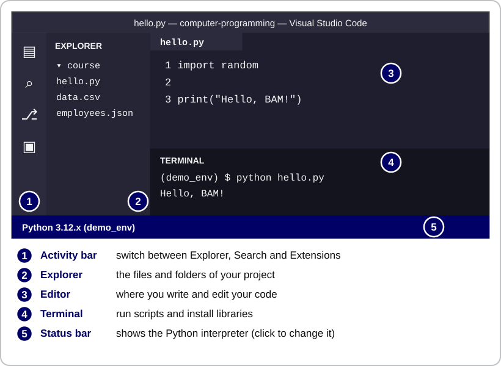

## Why VS Code?

So far we have written code in notebooks on Google Colab. Professional developers also use an **IDE** (integrated development environment): a program that combines a code editor, a terminal, a debugger and many extensions in one window. Other popular Python IDEs are PyCharm and Spyder. In this course we use **Visual Studio Code** (VS Code) because it is free, runs on Windows, macOS and Linux, and opens Jupyter notebooks (`.ipynb`) as well as plain Python scripts (`.py`).

::: {.callout-note}
## Before you start

- You need a laptop where you are allowed to install software. If it is managed by an organisation, install the **User** version (Windows) or ask your IT service.
- Install the English version of VS Code and set English as the working language. This makes it easier for classmates and instructors to help you.
- VS Code is the editor. It does **not** include Python. In step 2 you install **Anaconda**, which provides Python, the `conda` environment manager and Jupyter support.
:::

## 1. Install VS Code

Always download VS Code from the official site: [code.visualstudio.com/download](https://code.visualstudio.com/download). Choose your operating system below.

::: {.panel-tabset}

### Windows

1. On the download page, choose the **User Installer** for **Windows** (64-bit for most laptops). The *User* version does not need administrator rights.
2. Run the downloaded file (`VSCodeUserSetup-....exe`) and accept the licence agreement.
3. On the **Select Additional Tasks** screen, make sure **Add to PATH** is ticked. We recommend also ticking the options to add the "Open with Code" actions to the Windows Explorer menu, if they are shown.
4. Click **Install**, then **Finish**.
5. Check the installation. Open a **new** terminal (search for *PowerShell* in the Start menu) and run:

```bash
code --version
```

If you see a version number, the installation worked. If Windows says `code` is not recognised, close the terminal and open a new one. If it still fails, run the installer again and check that **Add to PATH** is ticked.

### macOS

1. On the download page, choose the **Universal** build for macOS. It works on both Apple silicon (M1 and later) and Intel Macs.
2. Open the downloaded file. Drag **Visual Studio Code** into the **Applications** folder.
3. Open VS Code from Applications (or Launchpad). If macOS asks whether you want to open an application downloaded from the internet, click **Open**.
4. Add the `code` command to the terminal. In VS Code, press `Cmd` + `Shift` + `P` to open the Command Palette, type **Shell Command: Install** and choose the entry for the `code` command in PATH (its full name is *Shell Command: Install 'code' and optionally 'copilot' commands in PATH*), then press `Enter`. (The option may also offer to install the Copilot command-line tool: you do not need it for this course.)
5. Check the installation. Open a **new** Terminal window and run:

```bash
code --version
```

### Linux

The best way depends on your distribution.

**Ubuntu, Debian and derivatives** (`.deb` package)

1. Download the `.deb` file from the [download page](https://code.visualstudio.com/download).
2. Open a terminal in the folder with the file and run (replace the file name with the one you downloaded):

```bash
sudo apt install ./code_*.deb
```

When asked whether to add the Microsoft repository, answer **yes**: it lets your system update VS Code automatically.

**Fedora, RHEL and derivatives**

```bash
sudo rpm --import https://packages.microsoft.com/keys/microsoft.asc
echo -e "[code]\nname=Visual Studio Code\nbaseurl=https://packages.microsoft.com/yumrepos/vscode\nenabled=1\nautorefresh=1\ntype=rpm-md\ngpgcheck=1\ngpgkey=https://packages.microsoft.com/keys/microsoft.asc" | sudo tee /etc/yum.repos.d/vscode.repo > /dev/null
sudo dnf check-update
sudo dnf install code
```

**Any distribution with Snap**

```bash
sudo snap install --classic code
```

**Arch Linux:** install the community package `visual-studio-code-bin` from the AUR (see the Arch Linux wiki for how to install AUR packages).

Check the installation:

```bash
code --version
```

:::

::: {.callout-tip}
## Windows students who use WSL

Some students prefer to work in a Linux environment inside Windows (WSL). It is optional in this course. If you choose it, install VS Code on Windows as above, then install the **WSL** extension (`ms-vscode-remote.remote-wsl`) from the Extensions view.
:::

## 2. Install Anaconda (Python and Conda)

VS Code needs a Python **interpreter** to run your code. In this course we install it with **Anaconda**, which also gives us `conda`, the tool we use to create *environments* and install libraries (see [Environments](environments.qmd)).

Download Anaconda Distribution from [anaconda.com/download](https://www.anaconda.com/download) (you may be asked to register with an email) and follow the steps for your system.

::: {.panel-tabset}

### Windows

1. Download the **Windows 64-Bit Graphical Installer** and run it from your **Downloads** folder.
2. Accept the Terms of Service and choose **Just Me (Recommended)**.
3. Choose a destination folder with **no spaces or special characters** in the path.
4. On the options screen:
   - Leave **Create shortcuts** ticked.
   - Leave **Add Anaconda3 to my PATH environment variable** **unticked**. Anaconda does not recommend it, and you will use the **Anaconda Prompt** instead.
   - Tick **Register Anaconda3 as my default Python**. This lets VS Code find it.
5. Click **Install**, then **Finish**.
6. Check the installation: search for **Anaconda Prompt** in the Start menu and open it. The prompt should start with `(base)`. Run:

```bash
conda --version
```

### macOS

1. Download the **64-Bit (Apple silicon) Graphical Installer**. To know which chip you have, open the Apple menu > **About This Mac**.
2. Double-click the `.pkg` file and click **Continue** until the licence screen. Accept the Terms of Service, keep the default location and click **Install**.
3. Open a **new** Terminal window. The prompt should start with `(base)`. Run:

```bash
conda --version
```

If you see `command not found: conda`, close and reopen the Terminal.

::: {.callout-note}
Anaconda stopped building installers for Intel Macs in August 2025. If your Mac has an Intel chip, ask your instructor which installer to use.
:::

### Linux

1. Download the installer for your architecture (x86_64 for most laptops) from the [download page](https://www.anaconda.com/download). The file ends in `.sh`.
2. Run it from the folder where it was saved (replace the file name with yours):

```bash
bash ~/Downloads/Anaconda3-*-Linux-x86_64.sh
```

3. Press `Enter` to read the Terms of Service, type `yes` to accept, press `Enter` to accept the default folder, and type `yes` when asked to initialise conda.
4. Close and reopen the terminal. The prompt should start with `(base)`. Check:

```bash
conda --version
```

:::

## 3. Install the extensions

VS Code is extended with small add-ons called **extensions**.

1. Click the **Extensions** icon in the left bar (four squares), or press `Ctrl` + `Shift` + `X` (`Cmd` + `Shift` + `X` on macOS).
2. Search for each of these and click **Install**:

| Extension | Publisher | What it does |
|---|---|---|
| **Python** | Microsoft | Runs and debugs Python code. |
| **Jupyter** | Microsoft | Opens and runs `.ipynb` notebooks. |
| **Pylance** | Microsoft | Autocompletion, type information and docstrings on hover. Usually installed together with Python. |
| **Ruff** | Astral Software | Formats your code in a consistent (PEP 8) style. |

You can also install them from a terminal:

```bash
code --install-extension ms-python.python
code --install-extension ms-toolsai.jupyter
code --install-extension charliermarsh.ruff
```

### Optional: format your code when you save

1. In the folder you work in, create a folder named `.vscode`.
2. Inside it, create a file named `settings.json` with this content:

```json
{
  "[python]": {
    "editor.defaultFormatter": "charliermarsh.ruff",
    "editor.formatOnSave": true,
    "editor.codeActionsOnSave": {
      "source.fixAll": "explicit",
      "source.organizeImports": "explicit"
    }
  },
  "notebook.formatOnSave.enabled": true
}
```

Now every time you press `Ctrl` + `S`, VS Code tidies your code.

## 4. Your first script

Before we write code, let us name the parts of the VS Code window. You will see these words many times.

{fig-alt="Schematic of the VS Code window with five numbered areas: the activity bar, the Explorer panel with your files, the editor, the terminal and the status bar that shows the Python interpreter." width="90%" fig-align="center"}

1. Create a folder for the course, for example `computer-programming`.
2. In VS Code, choose **File** > **Open Folder...** and select that folder. Click **Yes, I trust the authors** if VS Code asks.
3. In the Explorer panel, click the **New File** icon and name the file `hello.py`.
4. Type:

```python
print("Hello, BAM!")
```

5. Click the **Run Python File** button (a triangle, top right) or open the terminal with `` Ctrl+` `` and run:

```bash
python hello.py
```

Run this command in a terminal where the `(base)` environment is active. In VS Code, the integrated terminal activates it for you once the interpreter is selected.

If VS Code asks you to select an interpreter, press `Ctrl` + `Shift` + `P` (`Cmd` + `Shift` + `P` on macOS), choose **Python: Select Interpreter** and pick the interpreter whose name contains **base** or **conda** (the Anaconda Python from step 2).

## 5. Jupyter notebooks in VS Code

You can work with the same `.ipynb` notebooks that you use in Colab.

1. Press `Ctrl` + `Shift` + `P` (`Cmd` + `Shift` + `P` on macOS) and run **Create: New Jupyter Notebook**. Alternatively, create a file with the extension `.ipynb`.
2. Click **Select Kernel** (top right) and choose the Anaconda interpreter from step 2 (**Python Environments**, then the one named `base`). If VS Code offers to install the `ipykernel` package, accept. You can also install it yourself with `conda install ipykernel`.
3. Write code in a cell and run it with `Shift` + `Enter` (run and go to the next cell) or `Ctrl` + `Enter` (run and stay in the cell).
4. Save with `Ctrl` + `S` (`Cmd` + `S` on macOS).

If the notebook opens in **Restricted Mode** you cannot run cells. Choose **Trust** in the banner at the top.

::: {.callout-note}
## Exercise

1. Create a notebook called `first_notebook.ipynb` in your course folder.
2. In the first cell write a `print()` that shows your name, and run it.
3. In a second cell define a function `square(x)` that returns `x ** 2`, and call it with `7`.
4. Create a script `hello.py` that prints the same message as in your first notebook cell, and run it from the terminal.
:::

::: {.callout-tip collapse="true"}
## Solution

In the first cell of `first_notebook.ipynb` (replace the name with yours):

```python
print("Ana Pérez")
```

In the second cell:

```python
def square(x):
    return x ** 2


square(7)
```

The cell shows the output `49` below it. If VS Code asks for a kernel, choose the Anaconda interpreter (see step 5).

For the script, create `hello.py` in the same folder with the same message:

```python
print("Ana Pérez")
```

Open the terminal in VS Code (`` Ctrl+` ``) and run:

```bash
python hello.py
```

The terminal prints `Ana Pérez`. If you get `can't open file`, the terminal is not in the folder of `hello.py`: use `cd` to go there.
:::

## Troubleshooting

| Problem | What to try |
|---|---|
| `code` is not recognised in the terminal | Close the terminal and open a new one. On Windows, reinstall with **Add to PATH** ticked. On macOS, run **Shell Command: Install 'code' ... in PATH** from the Command Palette. |
| `conda` or `python` is not recognised | On Windows, open the **Anaconda Prompt** from the Start menu instead of PowerShell. On macOS and Linux, close and reopen the terminal. |
| No kernel appears in the notebook | Check that the Python and Jupyter extensions are installed and that Python is installed. Run **Python: Select Interpreter**. |
| Cells will not run | Check whether the notebook is in Restricted Mode and trust the folder. |

## Next step: environments {#next-step-environments}

A **conda environment** is a separate space with its own Python version and libraries, so projects do not interfere with each other. In [Python Environments with Conda](environments.qmd) we create one and use it in VS Code. As a preview:

```bash
conda create -n demo_env python=3.12
conda activate demo_env
conda install numpy ipykernel
```

---

# Need Help?

If you have any questions, feel free to reach out via email at [dprecioso@faculty.ie.edu](mailto:dprecioso@faculty.ie.edu)
