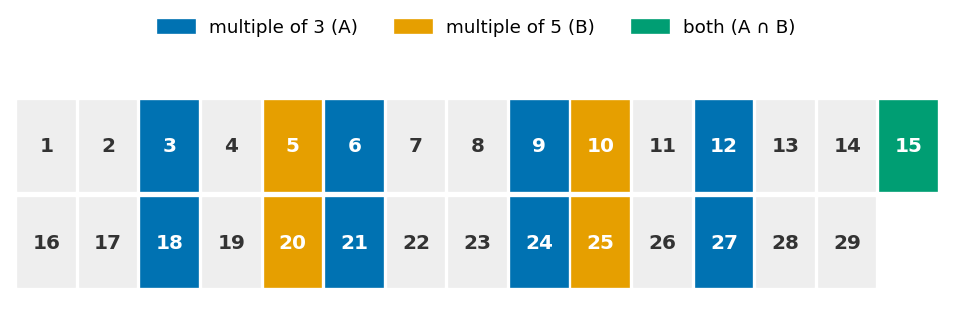
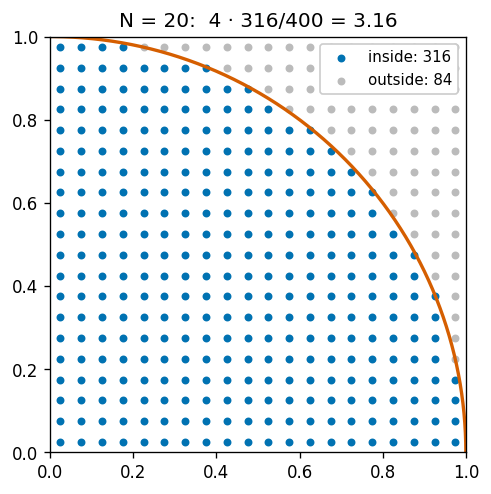
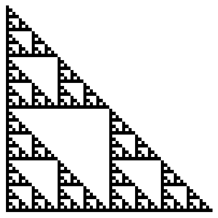

# Masking: Sets and Logic

Masking means using an array of `True` and `False` values to select or modify part of another array. If the idea feels new, here is the good news: you already know it from mathematics. **A mask is a set.** Every rule you know about sets (intersection, union, complement, counting) has a NumPy version.

In this lesson we build masks from numbers and treat them as sets. In the next lesson, [Masking with Images](masking_images.qmd), we apply the same rules to pictures.

```{python}
import matplotlib.pyplot as plt
import numpy as np
```

---

## A Mask Is a Set

Take the universe $U = \{1, 2, \dots, 20\}$ and the set of even numbers in it:

$$A = \{x \in U : x \text{ is even}\}$$

In NumPy, the universe is an array and the condition "$x$ is even" becomes a comparison:

```{python}
numbers = np.arange(1, 21)  # the universe U
is_even = numbers % 2 == 0  # the condition, checked for every element

print(numbers)
print(is_even)
```

The comparison does not return the set $A$ directly. It returns one answer per element of $U$: "is this element in $A$?". In mathematics this is the **indicator function** of $A$:

$$\mathbf{1}_A(x) = \begin{cases} 1 & \text{if } x \in A \\ 0 & \text{if } x \notin A \end{cases}$$

`True` behaves as `1` and `False` as `0`, so the mask *is* the indicator function evaluated on every element of $U$:

```{python}
print(is_even.astype(int))
```

To obtain the set itself, we index the universe with the mask. NumPy keeps the elements where the mask is `True`:

```{python}
print(numbers[is_even])  # the set A
```

::: {.callout-important}
## Two arrays, two roles

- `is_even` is the **mask**: it has the same length as `numbers`, and it only contains `True`/`False`.
- `numbers[is_even]` is the **selection**: it contains only the elements of $A$, so it is usually shorter.

Most masking errors come from mixing up these two arrays.
:::

---

## Set Operations Are Logical Operations

Let's add a second set, the multiples of 3: $B = \{x \in U : 3 \mid x\}$.

```{python}
is_mult3 = numbers % 3 == 0
print(numbers[is_mult3])  # the set B
```

Every set operation has an element-wise logical operator:

| Mathematics | Meaning | NumPy |
|---|---|---|
| $A \cap B$ | in $A$ **and** in $B$ | `is_even & is_mult3` |
| $A \cup B$ | in $A$ **or** in $B$ | <code>is_even &#124; is_mult3</code> |
| $A^c = U \setminus A$ | **not** in $A$ | `~is_even` |
| $A \setminus B$ | in $A$ and not in $B$ | `is_even & ~is_mult3` |
| $\lvert A \rvert$ | number of elements | `np.sum(is_even)` |
| $\lvert A \rvert / \lvert U \rvert$ | proportion of $U$ | `np.mean(is_even)` |
| $\exists x \in U : x \in A$ | at least one | `np.any(is_even)` |
| $\forall x \in U : x \in A$ | all of them | `np.all(is_even)` |

```{python}
print("A ∩ B:", numbers[is_even & is_mult3])
print("A ∪ B:", numbers[is_even | is_mult3])
print("A^c:  ", numbers[~is_even])
print("A \\ B:", numbers[is_even & ~is_mult3])
```

As expected, $A \cap B$ contains the multiples of 6.

Because `True` is `1` and `False` is `0`, adding a mask counts its elements, and averaging it gives a proportion, that is, the probability that a random element of $U$ belongs to the set:

```{python}
print("|A| =", np.sum(is_even))
print("|A ∩ B| =", np.sum(is_even & is_mult3))
print("P(x ∈ A ∪ B) =", np.mean(is_even | is_mult3))
```

`np.any()` and `np.all()` play the role of the quantifiers $\exists$ and $\forall$:

```{python}
print(np.any(numbers[is_even] > 15))  # is some even number above 15?
print(np.all(numbers[is_even & is_mult3] % 6 == 0))  # is every element of A ∩ B a multiple of 6?
```

::: {.callout-note}
## Exercise: De Morgan's Laws

De Morgan's laws state that

$$(A \cup B)^c = A^c \cap B^c \qquad \text{and} \qquad (A \cap B)^c = A^c \cup B^c$$

1. Write both sides of each law with the masks `is_even` and `is_mult3`, and check that they are equal with `np.array_equal()`.
2. Which numbers of $U$ are neither even nor multiples of 3? Answer with a single mask.
:::

::: {.callout-tip collapse="true"}
## Solution

```{python}
law_1 = np.array_equal(~(is_even | is_mult3), ~is_even & ~is_mult3)
law_2 = np.array_equal(~(is_even & is_mult3), ~is_even | ~is_mult3)
print(law_1, law_2)

print(numbers[~(is_even | is_mult3)])
```

These are the numbers coprime with 6. Notice that `np.array_equal()` returns a single `True` or `False`, while `==` on two arrays would return one value per element.
:::

---

## Masking with Numbers

Let's go back to the midterm one last time. In Session 15 we computed the final grade of every student, but we left one question open: **who passed?**

```{python}
students = np.array(["Ana", "Bruno", "Chloe", "Diego", "Emma", "Farid"])
final_grades = np.array([8, 5, 9, 4.5, 9, 5])

passed = final_grades >= 5

print(passed)
print(final_grades[passed])
```

The mask describes the set of students who passed. Because `students` is also an array with the same length, the same mask selects the names:

```{python}
print(students[passed])
print(students[~passed])  # the complement: who failed
```

Counting the set is a sum, as before:

```{python}
print(np.sum(passed), "students passed")
```

::: {.callout-note}
## Exercise: Passing Point, Revisited

In Session 15 we read from the output after which exercise Ana reached 50 points. Now let NumPy find it: combine a mask with `np.argmax()`, which returns the position of the first `True`.

```{python}
ana_cumulative = np.array([15, 35, 40, 50, 55, 60, 65, 65, 70, 75, 80])
```
:::

::: {.callout-tip collapse="true"}
## Solution

```{python}
reached = ana_cumulative >= 50
print(np.argmax(reached) + 1)  # 4
```

`np.argmax()` on a Boolean array returns the index of the first `True` (since `True` is the maximum). We add `1` to turn the index into an exercise number.
:::

::: {.callout-note}
## Exercise: Predict the Mask

Without running the code, write what it prints. Then modify it to select the values greater than or equal to `5`.

```python
values = np.array([2, 5, 8, 1, 9])
mask = values % 2 == 1
print(values[mask])
```
:::

::: {.callout-tip collapse="true"}
## Solution

```text
[5 1 9]
```

The mask is `True` for the odd values, so only those are selected.

```{python}
values = np.array([2, 5, 8, 1, 9])
mask = values >= 5
print(values[mask])  # [5 8 9]
```
:::

---

## Changing Values with a Mask

A mask on the left of `=` changes only the selected elements and leaves the rest untouched. Suppose every student gets 1.5 bonus points, but grades cannot go above 10:

```{python}
with_bonus = final_grades + 1.5
with_bonus[with_bonus > 10] = 10  # only the grades above 10 change

print(with_bonus)
```

When we want to choose between two values for every element, `np.where(mask, value_if_true, value_if_false)` builds a new array. It is the array version of `if ... else`:

```{python}
print(np.where(passed, "Pass", "Fail"))
```

---

## Common Pitfalls

### Parentheses around each condition

Run this code and read the error:

```{python}
#| eval: false
multiples = numbers[numbers % 3 == 0 | numbers % 5 == 0]
```

```text
ValueError: The truth value of an array with more than one element is ambiguous.
```

In Python, `|` and `&` are evaluated **before** `==`, so Python reads `numbers % 3 == (0 | numbers % 5) == 0`, which is not what we meant. Always wrap each condition in parentheses:

```{python}
multiples = numbers[(numbers % 3 == 0) | (numbers % 5 == 0)]
print(multiples)
```

### `and`, `or`, `not` do not work on arrays

```{python}
#| eval: false
both = (numbers % 3 == 0) and (numbers % 5 == 0)
```

```text
ValueError: The truth value of an array with more than one element is ambiguous.
```

The keywords `and`, `or` and `not` need one single `True` or `False`, and Python does not know how to turn a whole array into one value (should it use "any" or "all"?). For masks, use the element-wise operators `&`, `|` and `~`.

### Values are not positions

What is wrong with this code?

```{python}
#| eval: false
arr = np.array([2, 8, 1, 9, 3, 7])
high = arr[arr > 6]  # [8 9 7]
arr[high] = -1
```

```text
IndexError: index 8 is out of bounds for axis 0 with size 6
```

`high` contains the **values** of the selected elements, not their **positions**, so `arr[high]` tries to read position 8. Use the mask itself to modify the array:

```{python}
arr = np.array([2, 8, 1, 9, 3, 7])
arr[arr > 6] = -1
print(arr)
```

If you do need the positions of the `True` values, use `np.flatnonzero(mask)`.

---

## Exercises

::: {.callout-note}
## Multiples of 3 or 5

*Inspired by Project Euler, [Problem 1](https://projecteuler.net/problem=1).*

The natural numbers below 10 that are multiples of 3 or 5 are 3, 5, 6 and 9, and their sum is 23.

<p align="center">

</p>

1. Write a function `multiples_3_or_5(n)` that returns the sum of all the natural numbers below `n` that are multiples of 3 or 5. Use a mask instead of a loop. Check that `multiples_3_or_5(10)` returns `23`.
2. Let $A$ be the multiples of 3 below 1000 and $B$ the multiples of 5. Use masks to check the inclusion–exclusion principle: $|A \cup B| = |A| + |B| - |A \cap B|$. What is $A \cap B$?
3. The same principle works for sums. The multiples of $d$ below $n$ are $d, 2d, \dots, md$ with $m = \lfloor (n-1)/d \rfloor$, and their sum is $d \cdot \frac{m(m+1)}{2}$. Compute the answer for $n = 1000$ with this formula, without any array, and compare it with your function.
:::

::: {.callout-tip collapse="true"}
## Solution

```{python}
def multiples_3_or_5(n: int) -> int:
    """
    Sum the natural numbers below n that are multiples of 3 or 5.

    Parameters
    ----------
    n : int
        Upper limit (excluded). Must be positive.

    Returns
    -------
    int
        The sum of the multiples of 3 or 5 below n.
    """
    numbers = np.arange(1, n)
    mask = (numbers % 3 == 0) | (numbers % 5 == 0)
    return int(np.sum(numbers[mask]))


print(multiples_3_or_5(10))
```

```{python}
numbers = np.arange(1, 1000)
in_a = numbers % 3 == 0
in_b = numbers % 5 == 0

print(np.sum(in_a | in_b))
print(np.sum(in_a) + np.sum(in_b) - np.sum(in_a & in_b))
```

Both counts are equal. $A \cap B$ is the set of multiples of 15: they appear in both $A$ and $B$, so adding $|A|$ and $|B|$ counts them twice.

```{python}
def sum_of_multiples(d: int, n: int) -> int:
    """Sum the multiples of d below n with the triangular number formula."""
    m = (n - 1) // d
    return d * m * (m + 1) // 2


formula = sum_of_multiples(3, 1000) + sum_of_multiples(5, 1000) - sum_of_multiples(15, 1000)
print(formula, multiples_3_or_5(1000))
```

The formula needs three multiplications, whatever the value of $n$, while the mask builds an array of $n$ elements. Masks are a great way to *check* a formula, but a formula, when we have one, is faster.
:::

::: {.callout-note}
## Estimating π by Counting Points

The quarter disc $D = \{(x, y) \in [0, 1]^2 : x^2 + y^2 < 1\}$ has area $\pi / 4$. If we cover the unit square with a regular grid of $N \times N$ points, the proportion of points that fall inside $D$ approximates that area.

<p align="center">

</p>

1. Build the grid coordinates `x = (np.arange(N) + 0.5) / N`, the centres of $N$ equal cells.
2. Use broadcasting to build an $N \times N$ mask that is `True` where $x^2 + y^2 < 1$.
3. Use the mask to estimate $\pi$ for $N = 10, 100, 1000$. How fast does the error decrease?
4. Display the mask with `plt.imshow(inside, cmap="gray")`. This is an extension, remember `matplotlib` is not part of this course.

Hint: in step 2 you need *every* $x$ paired with *every* $y$. Turn one copy of the coordinates into a column and the other into a row. If you feel stuck, solve $N = 4$ first.
:::

::: {.callout-tip collapse="true"}
## Solution

**Step 1: one point.** A point of the grid is a pair $(x_j, y_i)$. Take a tiny grid, $N = 4$. The coordinates are the centres of four cells:

```{python}
N = 4
x = (np.arange(N) + 0.5) / N
print(x)
```

Is the point with $x$ = `x[2]` and $y$ = `x[1]` inside the disc? It is a single comparison:

```{python}
print(x[1] ** 2 + x[2] ** 2 < 1)
```

**Step 2: all the points, without a loop.** We have $4 \times 4 = 16$ points, one for every pair of indices $(i, j)$. We want a table where the entry `[i, j]` is `x[i]**2 + x[j]**2`. The trick is to give the two copies of `x` different shapes:

```{python}
column = x[:, np.newaxis]  # shape (4, 1): the values go down, along the rows
row = x[np.newaxis, :]     # shape (1, 4): the values go across, along the columns

print(column.shape, row.shape)
print(column)
print(row)
```

`np.newaxis` is a way to say "put an empty axis here". With `x[:, np.newaxis]` the colon keeps the original axis in the first position, and the new axis of length 1 goes second: **a column vector**. With `x[np.newaxis, :]` the new axis goes first: **a row vector**.

When we add a column `(4, 1)` and a row `(1, 4)`, broadcasting stretches both to `(4, 4)`, exactly as in [Session 15](arithmetics.qmd). Entry `[i, j]` combines `column[i]` with `row[j]`:

```{python}
squares = column**2 + row**2  # x[i]^2 + x[j]^2
print(squares.round(2))

inside = squares < 1
print(inside.astype(int))  # 1 = inside, 0 = outside
print(4 * np.mean(inside))
```

Of the $16$ points, $13$ are inside: the estimate is $4 \cdot 13 / 16 = 3.25$. With a grid this coarse we cannot expect more.

**Alternative with `reshape`.** `np.newaxis` is not the only way to build a row or a column. The method `reshape()` gives the same values a new shape, and `-1` means "whatever fits":

```{python}
column = x.reshape(-1, 1)  # N rows, 1 column
row = x.reshape(1, -1)     # 1 row, N columns

print(np.array_equal(column**2 + row**2 < 1, inside))
```

Both versions give the same result. `np.newaxis` says what we *add*, `reshape` says what we *want*. Use the one that reads better to you.

**Step 3: finer grids.** Now the same three lines work for any $N$, so we can loop over the sizes:

```{python}
for N in [10, 100, 1000]:
    x = (np.arange(N) + 0.5) / N
    inside = x[:, np.newaxis] ** 2 + x[np.newaxis, :] ** 2 < 1
    estimate = 4 * np.mean(inside)  # proportion of points inside, times 4
    print(f"N = {N:4d}: π ≈ {estimate:.6f}, error = {abs(estimate - np.pi):.6f}")
```

**Step 4: the picture.**

```{python}
N = 50
x = (np.arange(N) + 0.5) / N
inside = x[:, np.newaxis] ** 2 + x[np.newaxis, :] ** 2 < 1

plt.imshow(inside, cmap="gray", origin="lower")
plt.axis("off")
plt.show()
```

`np.mean(inside)` is $|D \cap \text{grid}| \,/\, |\text{grid}|$, so this is a counting version of an integral. In future sessions we will replace the regular grid with random points: that is the [**Monte Carlo** method](random_fancy_indexing.qmd).
:::

::: {.callout-note}
## Pascal's Triangle and the Sierpiński Triangle

Each row of Pascal's triangle is built from the previous one: every entry is the sum of the two entries above it, $\binom{n}{k} = \binom{n-1}{k-1} + \binom{n-1}{k}$. In our array, row $n$ is stored from column $0$, so "the two above" are the entry **directly above** (same column $k$) and the entry **above to the left** (column $k-1$).

1. Build a $64 \times 64$ array `pascal` where row $n$ holds $\binom{n}{0}, \dots, \binom{n}{n}$ followed by zeros. You may loop over the rows, but compute each row from the previous one in a single line, with slicing. To avoid huge numbers, store each entry **modulo 2**.
2. Build the mask of the odd entries and display it with `plt.imshow(odd, cmap="gray_r")`. Your result should look like the picture below. Do you recognise the shape? This is an extension, remember `matplotlib` is not part of this course.
3. How many entries of the first 64 rows are odd? Can you guess a formula for the first $2^k$ rows?

<p align="center">

</p>
:::

::: {.callout-tip collapse="true"}
## Solution

**Step 1: what "the two above" means.** Write two consecutive rows with the columns aligned:

```
column:        0   1   2   3   4   5
row n-1:       1   4   6   4   1   0
row n:         1   5  10  10   5   1
```

The `5` in column `1` of row $n$ is `1 + 4`, from columns `0` and `1` above it. The `10` in column `2` is `4 + 6`, from columns `1` and `2`. In general, the entry in column $k$ is the sum of columns $k-1$ and $k$ of the previous row. Seen from the previous row, each **neighbouring pair** `(i, i+1)` produces one entry of the new row, in column `i+1`. Column `0` is always `1`, because it has nothing to its left.

**Step 2: one row, by hand.** Keep the rows the same length, padded with zeros:

```{python}
previous = np.array([1, 4, 6, 4, 1, 0, 0, 0])
```

We need the pairs `(0, 1)`, `(1, 2)`, `(2, 3)`, and so on, all at once. Two slices of the same array do it:

```{python}
print(previous[:-1])  # columns 0 to N-2: the left member of every pair
print(previous[1:])   # columns 1 to N-1: the right member of every pair
```

- `previous[:-1]` means "everything except the last element".
- `previous[1:]` means "everything except the first element".

Both slices have $N - 1$ elements, and they are **shifted by one position**. Placed side by side, the element at position `i` of the first is `previous[i]`, and the element at position `i` of the second is `previous[i + 1]`:

```
previous[:-1]   1   4   6   4   1   0   0
previous[1:]    4   6   4   1   0   0   0
sum             5  10  10   5   1   0   0
```

Their sum is already the new row, except for the first `1`:

```{python}
new = np.zeros_like(previous)
new[0] = 1
new[1:] = previous[1:] + previous[:-1]
print(new)
```

The sum has $N - 1$ elements, so it goes into `new[1:]`, which also has $N - 1$. If the lengths did not agree, NumPy would raise an error: that is a useful check.

**Step 3: all the rows.** Put the same line inside a loop over the rows of a 2D array. A row `pascal[n]` is the new row, and `pascal[n - 1]` is the previous one. The `% 2` keeps only the parity, to avoid huge numbers:

```{python}
N = 64
pascal = np.zeros((N, N), dtype=int)
pascal[:, 0] = 1  # the first entry of every row is 1

for n in range(1, N):
    pascal[n, 1:] = (pascal[n - 1, 1:] + pascal[n - 1, :-1]) % 2

print(pascal[:6, :6])  # the first rows of the triangle, modulo 2
```

**Step 4: the odd entries.**

```{python}
odd = pascal == 1

plt.imshow(odd, cmap="gray_r")
plt.axis("off")
plt.show()

print(np.sum(odd), 3**6)
```

The odd entries draw the Sierpiński triangle, a fractal. The first $2^k$ rows contain $3^k$ odd entries: each triangle is made of three copies of the previous one, each with half the size.

**Bonus.** Lucas's theorem says that $\binom{n}{k}$ is odd exactly when every binary digit of $k$ is at most the matching digit of $n$. With integers, `&` is the bitwise AND, so this condition is `(n & k) == k`, and the whole mask can be built without any loop:

```{python}
n = np.arange(N)[:, np.newaxis]
k = np.arange(N)[np.newaxis, :]
odd_lucas = (k <= n) & ((n & k) == k)

print(np.array_equal(odd, odd_lucas))
```

This is also why `&` works on masks: `True` and `False` are the bits `1` and `0`, and AND on a single bit is exactly the logical "and".
:::

::: {.callout-note}
## Is It Increasing?

You have a function $f$ and you want to know if it is **monotonically increasing** on $[a, b]$, which means $f(x) < f(y)$ whenever $x < y$. You cannot check infinitely many points, so you draw $1000$ equally spaced values of $x$ and evaluate $f$ at each of them.

1. For $f(x) = x + 0.3 \sin x$ on $[0, 10]$, build the array `y` with the $1000$ values.
2. Build a mask `up` that says, for each pair of **consecutive** values, whether the function went up. Hint: you need `y[i]` and `y[i + 1]` for every `i`. How can two slices give you that?
3. Is the function increasing on $[0, 10]$?
4. Repeat with $g(x) = x + 2 \sin x$. If it is not increasing, how many steps go down, and near which values of $x$?
:::

::: {.callout-tip collapse="true"}
## Solution

```{python}
x = np.linspace(0, 10, 1000)
y = x + 0.3 * np.sin(x)
```

We want to compare `y[0]` with `y[1]`, `y[1]` with `y[2]`, and so on. Do it with two slices: `y[1:]` holds the **next** value of every position, and `y[:-1]` holds the **current** value of every position, as in Pascal's triangle.

```{python}
up = y[1:] > y[:-1]  # up[i] is True when y[i + 1] > y[i]

print(up.shape)      # one step less than values: 999 steps between 1000 points
print(np.all(up))    # "for all steps, the function went up"
```

The function is increasing at every sampled step. Now the second function:

```{python}
y2 = x + 2 * np.sin(x)
up2 = y2[1:] > y2[:-1]

print(np.all(up2))
print(np.sum(~up2))                # number of steps that go down
print(x[:-1][~up2][[0, -1]])       # first and last x where it goes down
```

The mask `up2` has `False` where the function goes down, so it is the set of "bad steps". We can use it to index `x[:-1]`, because `up2` has one element less than `x`: element `i` of the mask describes the step from `x[i]` to `x[i + 1]`.

**Caution.** This is **evidence**, not a proof. If the function has a short dip between two sampled points, we will never see it. A finer grid reduces the risk, but only the derivative can give certainty. In this case, $f'(x) = 1 + 0.3\cos x > 0$ and $g'(x) = 1 + 2\cos x$ changes sign, which agrees with what we found.
:::

::: {.callout-important}
## The Neighbours Cheat-Code: `a[1:]` and `a[:-1]`

For an array `a` of length $N$:

| Expression | Meaning | Length |
|:--|:--|:-:|
| `a[:-1]` | every element **except the last**: each position's *current* value | $N - 1$ |
| `a[1:]` | every element **except the first**: each position's *next* value | $N - 1$ |

The two slices are the same array shifted by one place, so operating on them **pairs every element with its right-hand neighbour**, with no loop. The result has $N - 1$ elements, one for every pair of neighbours.

| You want | Write | Example |
|:--|:--|:--|
| The change between neighbours | `a[1:] - a[:-1]` (same as `np.diff(a)`) | daily changes in a price |
| The relative change | `a[1:] / a[:-1] - 1` | daily returns, see [Exercise Assets](exercise_assets.qmd) |
| Is it increasing? | `np.all(a[1:] > a[:-1])` | the exercise above |
| Where does it go down? | `np.where(a[1:] < a[:-1])` | the exercise above |
| Do neighbours sum to something? | `a[1:] + a[:-1]` | Pascal's triangle |

Remember the rule: `a[:-1]` is **where I am** and `a[1:]` is **where I go next**.
:::

---

## Summary and Reflection

- A Boolean mask is the indicator function of a set: one `True`/`False` per element.
- `array[mask]` retrieves the elements of the set; `array[mask] = value` modifies only them.
- `&`, `|` and `~` are intersection, union and complement. Place each comparison in parentheses.
- `np.sum(mask)` counts the elements of the set and `np.mean(mask)` gives its proportion.
- `np.any()` and `np.all()` are the quantifiers "there exists" and "for all".
- `np.where(mask, a, b)` chooses between two values for every element.
- `a[1:]` and `a[:-1]` pair every element with its next neighbour: a loop-free way to compare consecutive values.

Explain why Python's scalar operators `and`, `or`, and `not` cannot be used directly with Boolean arrays.

---

# Next: Masking with Images

Now apply the same ideas to pictures.

[Masking with Images](masking_images.qmd){.btn .btn-primary}

# Homework and Review

Work through the homework exercises available here.

[Homework](homework_numpy.qmd#masking){.btn .btn-primary}
