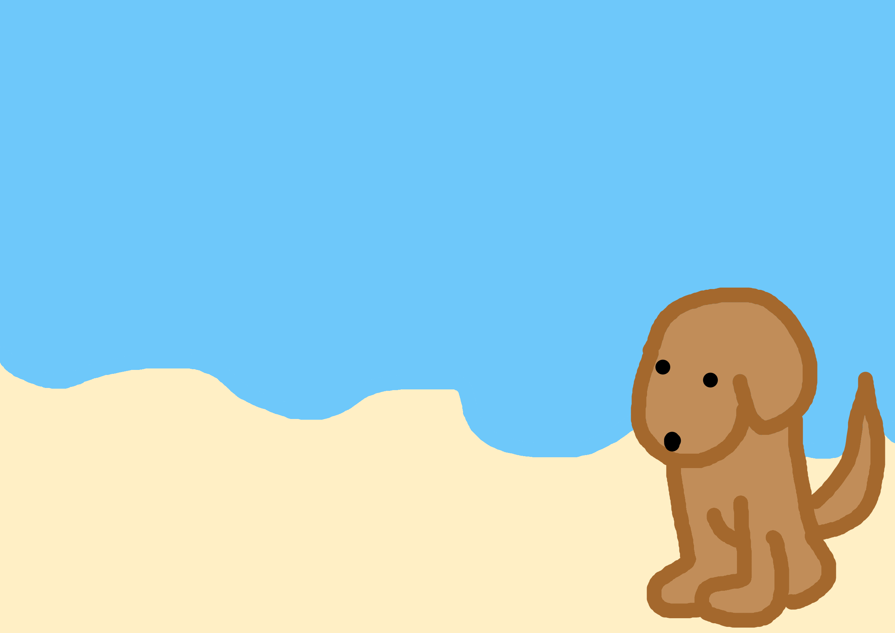
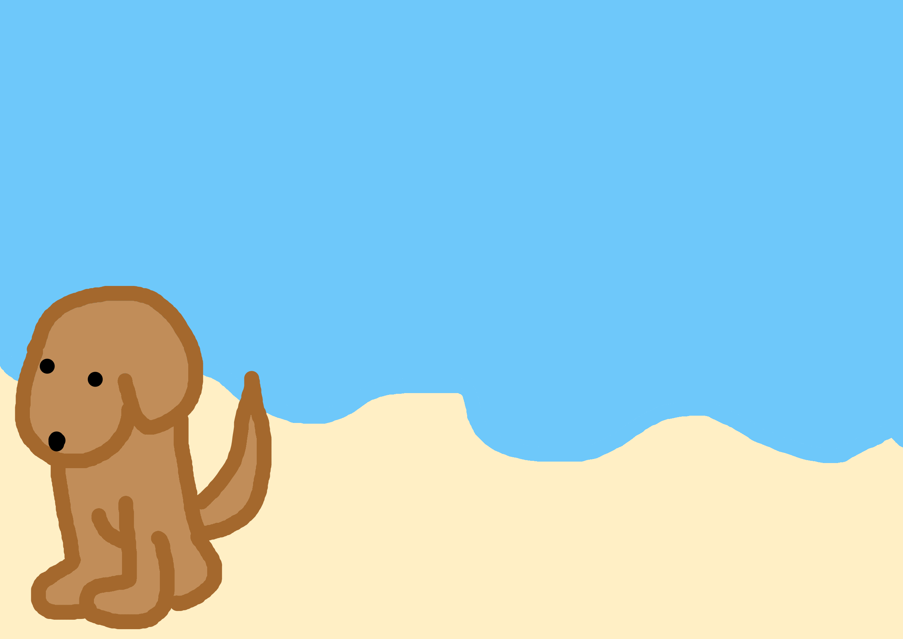
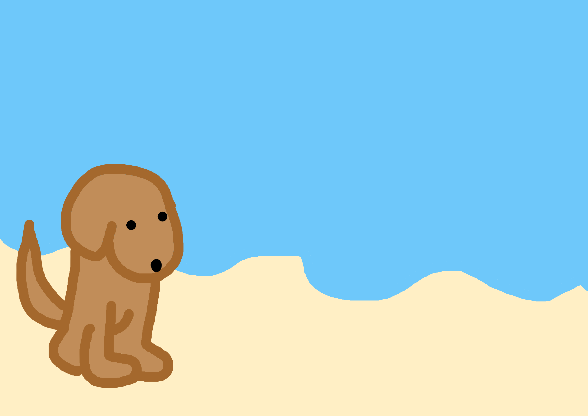
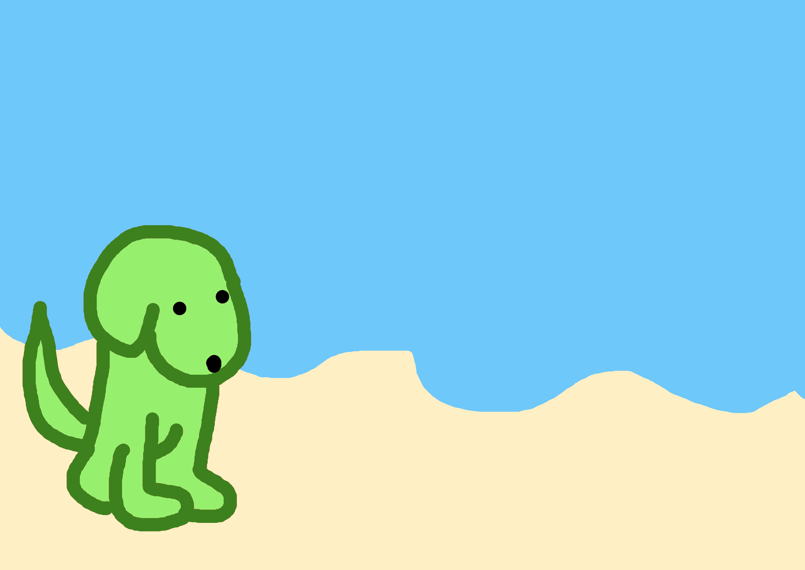
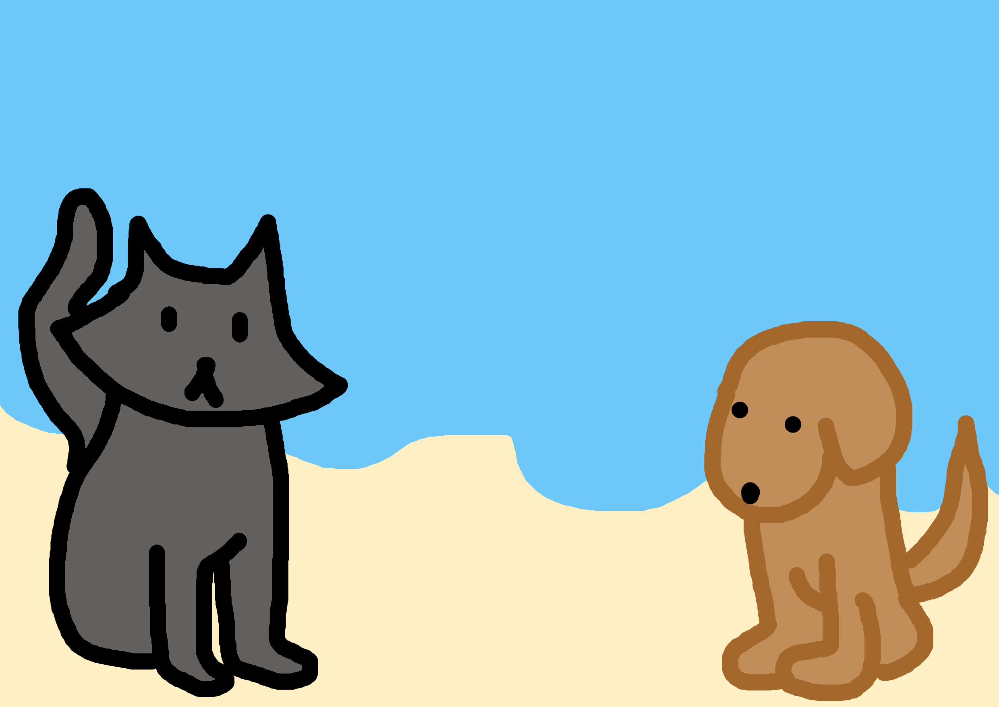
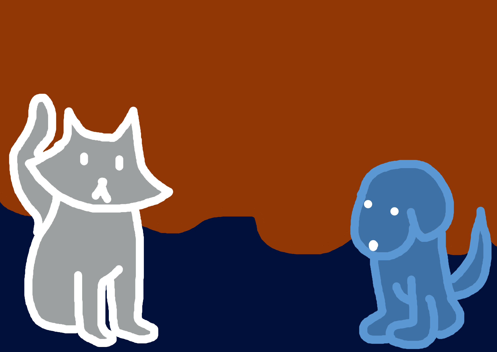
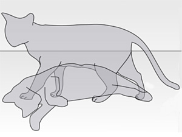
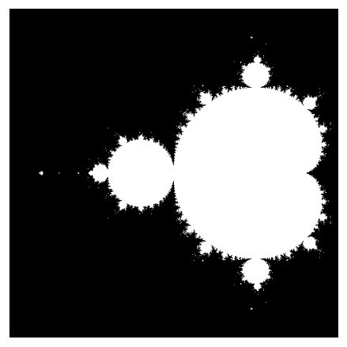

# Masking with Images

In [Masking: Sets and Logic](masking.qmd) we used Boolean arrays to describe sets of numbers. Now we apply exactly the same rules to pictures. An image is just an array of pixel values, so a mask is the set of pixels we want to select or change.

In this lesson we will cut a dog out of one picture and place it on a beach, and finish by drawing one of the most famous sets in mathematics.

---

## Setting Up

We only need NumPy and Matplotlib.

```{python}
import matplotlib.pyplot as plt  # to display images
import numpy as np  # for numerical operations on arrays
```

`show_image` displays an array as a picture: a grayscale image, a colour image, or a mask.

```{python}
def show_image(img: np.ndarray):
  """
  Display a NumPy array as an image.

  Parameters
  ----------
  img : np.ndarray
    A 2D array (grayscale image with values from 0 to 255, or Boolean mask)
    or a 3D array of shape (rows, columns, 3) (colour image).
  """
  if img.ndim == 3:  # Colour image
    plt.imshow(img.astype(np.uint8))
  elif img.dtype == bool:  # Mask
    plt.imshow(img, cmap="gray", vmin=0, vmax=1)
  else:  # Grayscale image
    plt.imshow(img, cmap="gray", vmin=0, vmax=255)
  plt.axis("off")
  plt.show()
  plt.close()
```

---

## Loading the Images: A Review of Session 17

In Session 17 we loaded the ghost photos from text files on the internet. Our pictures are stored in the same way: each file is a table of numbers, one per pixel, from `0` (black) to `255` (white). `BASE` is the address of the folder:

```{python}
BASE = "https://raw.githubusercontent.com/daniprec/Python-Course/main/data/masking"
```

`np.loadtxt()` reads a text file straight from its URL. It returns floats by default, but pixels are integers, so we ask for `dtype=int`:

```{python}
dog = np.loadtxt(f"{BASE}/dog.txt", dtype=int)

print(f"The array has shape: {dog.shape}")
print(f"The array contains values of type: {dog.dtype}")
print(f"Values from {dog.min()} to {dog.max()}\n")
show_image(dog)
```

::: {.callout-note}
## Remember: `np.load()` vs `np.loadtxt()`

`np.loadtxt()` reads text files, also from a URL. `np.load()` reads the binary `.npy` files that `np.save()` writes on your computer. At the end of the lesson you will use both to keep your collage.
:::

## Masking: The Basics

Masking is a technique where we create a boolean array (mask) of the same shape as our data. Here, we will create a mask for the dog image to identify regions with the dog's presence.

In our case, any pixel value greater than 0 in the grayscale image indicates the presence of the dog, so we will use this criterion to generate our mask.

```{python}
mask_dog = dog > 0
print(f"The mask contains values of type: {mask_dog.dtype}\n")

show_image(mask_dog)
```

## Loading a Second Image

Now, let's load another image, this time of a beach. We will later superimpose our dog image onto this beach image.

```{python}
beach = np.loadtxt(f"{BASE}/beach.txt", dtype=int)
beach_original = beach.copy()  # keep an untouched copy for the exercises

print(f"The array has shape: {beach.shape}")
show_image(beach)
```

We keep a copy because masking assignments change the array **in place**: once the dog is pasted, the original beach is gone.

## Creating a Mask for the Beach Image

We'll create an initial mask for the beach image, initialized to all zeros (or `False`). This represents that no part of the beach image is currently masked.

```{python}
mask_beach = np.zeros(beach.shape)  # type: int (0)
mask_beach = mask_beach.astype(bool)  # type: bool (False)
print(f"The mask has dimension: {mask_beach.ndim}")
print(f"The mask contains values of type: {mask_beach.dtype}\n")

show_image(mask_beach)
```

## Positioning the Dog Mask on the Beach Mask

Our goal is to superimpose the dog onto the beach image. To do this, we'll first position the dog mask at the bottom right corner of the beach mask.

```{python}
# Get the width and height of the dog image
h, w = mask_dog.shape
print(f"The dog mask has shape ({h}, {w})")

# Use clever indexing to replace a part of the beach mask with the dog
mask_beach[-h:, -w:] = mask_dog
print(f"The mask has dimension: {mask_beach.ndim}")
print(f"The mask contains values of type: {mask_beach.dtype}\n")

show_image(mask_beach)
```

## Superimposing the Dog Image onto the Beach Image

With our masks ready, we can now superimpose the dog image onto the beach image. By using the masks, we ensure that only the region with the dog gets overlaid onto the beach image.

```{python}
beach[mask_beach] = dog[mask_dog]

show_image(beach)
```

::: {.callout-note}
## Exercise: Save the Evidence

As with the ghost photos, save your collage with `np.save()`, load it back with `np.load()`, and check that both arrays are equal. Can you also save it with `np.savetxt()`?
:::

::: {.callout-tip collapse="true"}
## Solution

```{python}
#| eval: false
np.save("dog_on_beach.npy", beach)
collage = np.load("dog_on_beach.npy")
print(np.array_equal(beach, collage))  # True

np.savetxt("dog_on_beach.txt", beach, fmt="%d")
```

`np.save()` keeps the shape and the data type exactly. `np.savetxt()` writes readable text, but only for 1D and 2D arrays: keep that in mind for colour images.
:::

---

## Practice

::: {.callout-note}
## Exercise: Adjusting Color and Size

Try to do the same thing using this other image. You will realise two issues:

1. There is a white border around the image! How can you use masking to get rid of it?
2. This dog is much bigger! How can you make this picture smaller so that it fits neatly in the beach?

```{python}
#| eval: false
dog_2 = np.loadtxt(f"{BASE}/dog_2.txt", dtype=int)
```
:::

::: {.callout-tip collapse="true"}
## Solution

```{python}
# Load and display the image
dog_2 = np.loadtxt(f"{BASE}/dog_2.txt", dtype=int)

show_image(dog_2)
# Problem: We have to take away both black and white rectangle
```

```{python}
# Solution:
# Combine masks using "&" (and), similar to how we do "if" clauses
mask_dog_2 = (dog_2 > 0) & (dog_2 < 255)

show_image(mask_dog_2)
```

```{python}
# Start again from a clean beach
beach_2 = beach_original.copy()

mask_beach_2 = np.zeros(beach_2.shape)  # type: int (0)
mask_beach_2 = mask_beach_2.astype(bool)  # type: bool (False)

# Get the width and height of the dog image
h, w = mask_dog_2.shape

# Use clever indexing to replace a part of the beach mask with the dog
mask_beach_2[-h:, -w:] = mask_dog_2

show_image(mask_beach_2)
# Problem: the dog is too big
```

```{python}
# Solution:
# Use clever slicing to take one of every two pixels
dog_smol = dog_2[::2, ::2]

mask_smol = (dog_smol > 0) & (dog_smol < 255)

mask_beach_smol = np.zeros(beach_2.shape)  # type: int (0)
mask_beach_smol = mask_beach_smol.astype(bool)  # type: bool (False)

# Get the width and height of the dog image
h, w = mask_smol.shape

# Use clever indexing to replace a part of the beach mask with the dog
mask_beach_smol[-h:, -w:] = mask_smol

show_image(mask_beach_smol)
```

```{python}
# Finally, we add the dog using masking
beach_2[mask_beach_smol] = dog_smol[mask_smol]

show_image(beach_2)
```

:::

::: {.callout-note}
## Exercise: Color Images

The colour versions are `dog_rgb.txt` and `beach_rgb.txt`. A colour image has three numbers per pixel (red, green, blue), so its shape is `(rows, columns, 3)`. But `np.savetxt()` only writes 2D arrays, so the files store each image with shape `(rows, columns * 3)`.

1. Load both files and `reshape()` them back to 3D (Session 16). Hint: `-1` lets NumPy compute one dimension for you.
2. Repeat the exercise with the colour images.

<p align="center">

</p>
:::

::: {.callout-tip collapse="true"}
## Solution

Each row of the file holds the three channels of every pixel, one pixel after another, so `reshape(rows, -1, 3)` restores the image. The mask has the same 3D shape, so the same indexing works; we only need to unpack three values from `shape`.

```{python}
dog_rgb = np.loadtxt(f"{BASE}/dog_rgb.txt", dtype=int)
beach_rgb = np.loadtxt(f"{BASE}/beach_rgb.txt", dtype=int)
print(dog_rgb.shape, beach_rgb.shape)  # 2D, as stored

dog_rgb = dog_rgb.reshape(dog_rgb.shape[0], -1, 3)
beach_rgb = beach_rgb.reshape(beach_rgb.shape[0], -1, 3)
beach_rgb_original = beach_rgb.copy()
print(dog_rgb.shape, beach_rgb.shape)  # 3D

mask_dog_rgb = dog_rgb > 0

mask_beach_rgb = np.zeros(beach_rgb.shape).astype(bool)
h, w, _ = mask_dog_rgb.shape
mask_beach_rgb[-h:, -w:] = mask_dog_rgb

beach_rgb[mask_beach_rgb] = dog_rgb[mask_dog_rgb]
show_image(beach_rgb)
```
:::

::: {.callout-note}
## Exercise: Different Position

Now try to insert the puppy on the bottom left corner.

<p align="center">

</p>
:::

::: {.callout-tip collapse="true"}
## Solution

Only the column slice changes: the first `w` columns instead of the last `w`.

```{python}
beach_3 = beach_original.copy()

mask_beach_3 = np.zeros(beach_3.shape).astype(bool)
h, w = mask_dog.shape
mask_beach_3[-h:, :w] = mask_dog

beach_3[mask_beach_3] = dog[mask_dog]
show_image(beach_3)
```
:::

::: {.callout-note}
## Exercise: Flipping Arrays

The puppy would rather look at the beach. Can you flip it?

<p align="center">

</p>
:::

::: {.callout-tip collapse="true"}
## Solution

A negative step on the column axis reverses the columns, which mirrors the image horizontally.

```{python}
dog_flipped = dog[:, ::-1]
mask_flipped = dog_flipped > 0

beach_4 = beach_original.copy()
mask_beach_4 = np.zeros(beach_4.shape).astype(bool)
h, w = mask_flipped.shape
mask_beach_4[-h:, -w:] = mask_flipped

beach_4[mask_beach_4] = dog_flipped[mask_flipped]
show_image(beach_4)
```
:::

::: {.callout-note}
## Exercise: Green Dog

Can you change the dog's color to green?

<p align="center">

</p>
:::

::: {.callout-tip collapse="true"}
## Solution

Work with the color image. A pixel belongs to the dog if any of its channels is above zero, so we add the channels and compare. Assigning `[0, 255, 0]` to a masked selection paints every selected pixel pure green.

```{python}
dog_green = dog_rgb.copy()
mask_pixels = dog_green.sum(axis=2) > 0  # 2D mask: one value per pixel
dog_green[mask_pixels] = [0, 255, 0]

beach_5 = beach_rgb_original.copy()
mask_beach_5 = np.zeros(beach_5.shape[:2]).astype(bool)
h, w = mask_pixels.shape
mask_beach_5[-h:, -w:] = mask_pixels

beach_5[mask_beach_5] = dog_green[mask_pixels]
show_image(beach_5)
```
:::

::: {.callout-note}
## Exercise: Harder Masking

Speaking about green, the dog has a cat friend, but its image appears with a green background! Try to crop the cat out of its image and insert it in the beach.

<p align="center">

</p>

It is stored like the other colour images, in `cat_green_rgb.txt`.
:::

::: {.callout-tip collapse="true"}
## Possible solution

A background pixel has a strong green channel and weaker red and blue channels. The thresholds below are a starting point; adjust them while looking at `show_image(mask_cat)`.

```{python}
cat = np.loadtxt(f"{BASE}/cat_green_rgb.txt", dtype=int)
cat = cat.reshape(cat.shape[0], -1, 3)
cat = cat[::2, ::2]  # make it smaller if it does not fit

red = cat[:, :, 0]
green = cat[:, :, 1]
blue = cat[:, :, 2]

background = (green > red + 30) & (green > blue + 30)
mask_cat = ~background
show_image(mask_cat)

beach_6 = beach_rgb_original.copy()
mask_beach_6 = np.zeros(beach_6.shape[:2]).astype(bool)
h, w = mask_cat.shape
mask_beach_6[-h:, :w] = mask_cat

beach_6[mask_beach_6] = cat[mask_cat]
show_image(beach_6)
```
:::

::: {.callout-note}
## Exercise: Invert Colors

Let's finish with something easier. Invert the colors of the image.

<p align="center">

</p>
:::

::: {.callout-tip collapse="true"}
## Solution

Pixel values go from `0` to `255`, so the inverse of a value `v` is `255 - v`. Broadcasting applies it to every pixel at once.

```{python}
inverted = 255 - beach_original
show_image(inverted)
```
:::

---

## Challenge: Schrödinger's Cat

In the realm of quantum mechanics, Schrödinger's cat thought experiment poses a scenario where a cat is simultaneously both alive and dead until it is observed. As a nod to this concept, let's create an image representation where both a live cat and a skeletal cat are superimposed.

### Objective:
Produce an image where both the alive cat and the skeletal cat appear superimposed by alternating the pixels from each image.

<p align="center">

</p>


### Instructions:
1. Consider two images: one representing a live cat (denoted by 'a') and the other representing a skeletal cat (denoted by 'd').
2. To superimpose the images, alternate the pixels such that each pixel from one image is surrounded by pixels from the other image. This will give the effect of both images being merged into one.

For instance, your pixel arrangement might look like this:

```
[
  [a, d, a],
  [d, a, d],
  [a, d, a]
]
```

Here, 'a' represents a pixel from the live cat image, and 'd' represents a pixel from the skeletal cat image. The resulting image will have an even distribution of pixels from both images.

### Note:
This method effectively reduces the resolution of each image by half, but when viewed from a distance, the viewer should be able to discern both images superimposed upon each other.


```{python}
# Start with this image
schrodinger = np.loadtxt(f"{BASE}/cat_skeleton.txt", dtype=int)

show_image(schrodinger)
```

Your first step is to split that image into two (the skeleton and the cat). Then you will have to flip one of them so that both look at the same direction.

::: {.callout-tip collapse="true"}
## Solution

```{python}
h, w = schrodinger.shape
half = w // 2

# Split the picture into its two halves (same width for both)
left = schrodinger[:, :half]
right = schrodinger[:, half:2 * half]

# Alternatively, you can use np.split:
left, right = np.split(schrodinger, 2, axis=1)

# Flip the right half so both animals face the same direction
right = right[:, ::-1]

# Checkerboard mask: True where (row + column) is even
checkerboard = np.zeros(left.shape).astype(bool)
checkerboard[::2, ::2] = True
checkerboard[1::2, 1::2] = True

superposition = right.copy()
superposition[checkerboard] = left[checkerboard]

show_image(superposition)
```

If the result looks like two shifted animals, crop a few columns from one half so both figures line up before combining them.
:::

---

## Challenge: The Mandelbrot Set

Masks do not need to come from a photo: we can also *compute* the image. The Mandelbrot set $M$ is the set of complex numbers $c$ for which the sequence

$$z_0 = 0, \qquad z_{k+1} = z_k^2 + c$$

stays bounded. It can be proved that once $|z_k| > 2$ the sequence escapes to infinity, so we can test each point by iterating a fixed number of times and checking whether it has escaped.

Your task is to draw $M$ on the region $-2 \le \operatorname{Re}(c) \le 0.5$, $-1.25 \le \operatorname{Im}(c) \le 1.25$, without looping over the pixels. You may loop over the iterations.

1. Build a 2D array `c` of complex numbers, one per pixel. Hint: broadcast a row of real parts against a column of imaginary parts, `x[np.newaxis, :] + 1j * y[:, np.newaxis]`.
2. Start with `z = np.zeros_like(c)` and a mask `inside` that is `True` everywhere.
3. At each iteration, update `z` **only** where `inside` is `True`, then remove from `inside` the points with `np.abs(z) > 2`.
4. Show `inside` as an image. It should look like this:

<p align="center">

</p>

As a bonus, store in an integer array the iteration at which each point escaped, and display that array instead. It gives the familiar coloured picture.

::: {.callout-tip collapse="true"}
## Solution

```{python}
x = np.linspace(-2, 0.5, 500)
y = np.linspace(-1.25, 1.25, 500)
c = x[np.newaxis, :] + 1j * y[:, np.newaxis]

z = np.zeros_like(c)
inside = np.ones(c.shape, dtype=bool)
escape_time = np.zeros(c.shape, dtype=int)

for k in range(50):
    z[inside] = z[inside] ** 2 + c[inside]  # only update the points still inside
    escaped = inside & (np.abs(z) > 2)       # escaped in this iteration
    escape_time[escaped] = k
    inside[escaped] = False                  # remove them from the set

show_image(inside)

plt.imshow(escape_time, cmap="magma")
plt.axis("off")
plt.show()
```

Updating only `z[inside]` is what makes the masks essential: without it, the escaped points keep growing until they overflow.
:::

---

## Summary and Reflection

- An image is an array, so the same masking rules apply to pixels. Images stored as text load with `np.loadtxt()`, as in Session 17.
- `image[mask]` retrieves the pixels where the mask is `True`, and `image[mask] = value` changes only those pixels.
- A mask can be placed inside a larger one with slicing, to choose where a picture goes.
- In a colour image, a 2D mask selects whole pixels (all three channels at once).
- A mask can also be computed from a mathematical rule, as in the Mandelbrot set.

Why are the colour images stored with shape `(rows, columns * 3)`, and why must you keep a copy of the beach before pasting the dog?

---

# Homework and Review

Work through the homework exercises available here.

[Homework](homework_numpy.qmd#masking){.btn .btn-primary}
