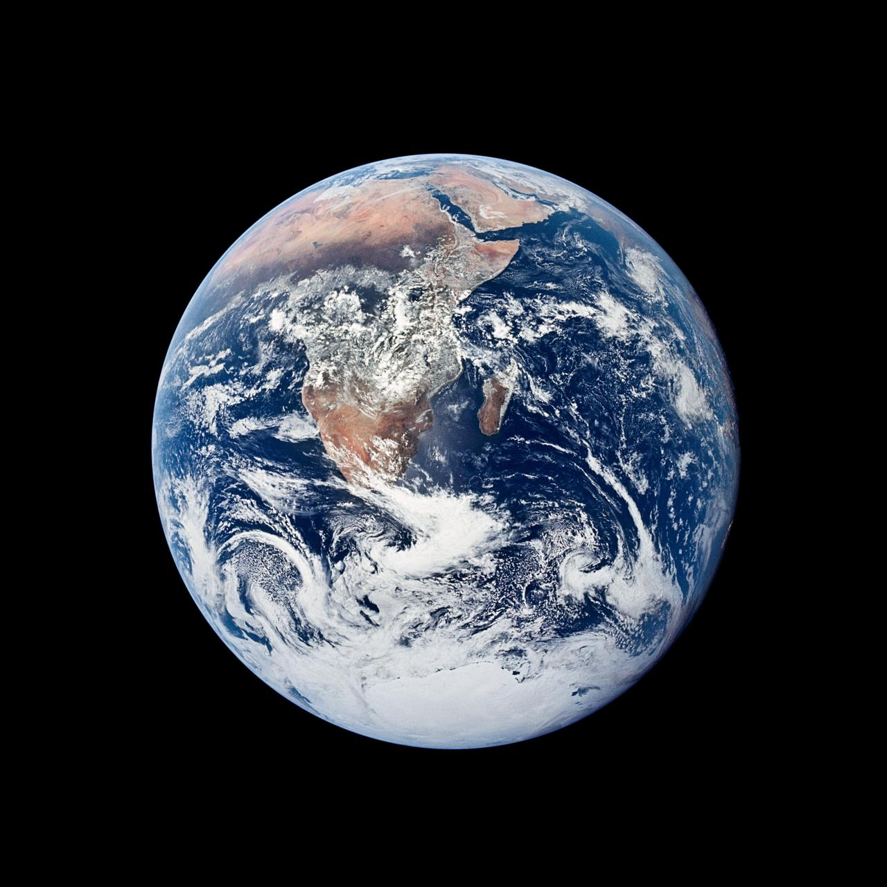
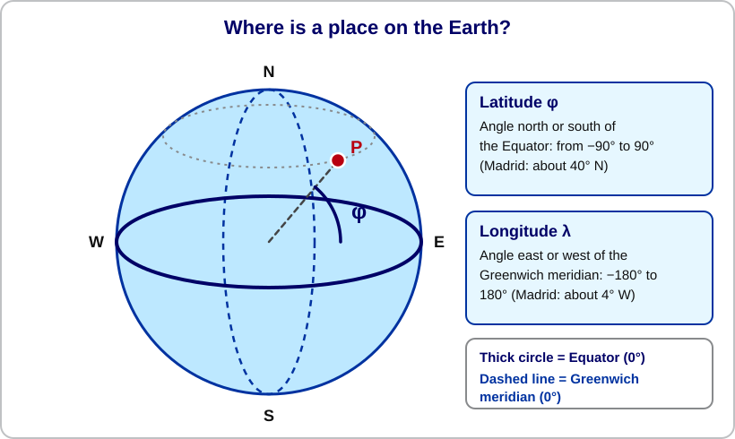
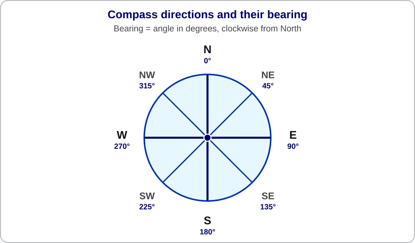

Build the logic of a capital-guessing game. The computer secretly chooses one national capital, and you have six guesses. After each guess, the game shows the approximate distance to the hidden capital and the compass direction to travel. You will write the functions that produce these clues, and a supplied interface will connect them to a globe, a direction arrow, and an attempt counter.

Main concepts: lists, dictionaries, NumPy arrays, `reshape` and broadcasting, vectorized trigonometry, and functions that work together.

{fig-alt="The Earth as a blue and white sphere against black space, with Africa and the Arabian Peninsula visible." width="45%" fig-align="center"}

::: {.callout-note}
## Colab activity

The interface uses `plotly` and `ipywidgets`, so run this project in Google Colab or in a Jupyter environment with both libraries installed. The page displays its code without executing it during website rendering.
:::

## The data

The table has one row per capital city of the world, with its latitude and longitude. **Latitude** tells how far north or south a place is from the Equator, and **longitude** how far east or west it is from the Greenwich meridian. Madrid, for example, is about 40 degrees north and 4 degrees west.

{fig-alt="A globe with the equator drawn as a thick circle and the Greenwich meridian as a dashed line. A point P is marked, with its latitude shown as an angle phi measured up from the equator. Side boxes explain latitude and longitude and give Madrid as an example, about 40 degrees north and 4 degrees west." width="90%" fig-align="center"}


The data cell downloads the table and builds two objects that use the same order: row 0 belongs to the first capital, row 1 to the second, and so on.

- `city_names`: a Python list with the names of the capitals.
- `coordinates`: a NumPy array with shape `(N, 2)`, where `N` is the number of capitals. Column 0 is the latitude and column 1 is the longitude, both in degrees.

```{python}
import csv
import io
from urllib.request import urlopen

import numpy as np

BASE = "https://raw.githubusercontent.com/daniprec/Python-Course/main/data/capitals"

with urlopen(f"{BASE}/country-capital.csv", timeout=30) as response:
    csv_text = response.read().decode("utf-8")

capital_locations = {}
for row in csv.DictReader(io.StringIO(csv_text)):
    name = row["capital_city"].strip()
    if name:
        capital_locations.setdefault(
            name.casefold(), (name, float(row["latitude"]), float(row["longitude"]))
        )

# Names in a Python list, coordinates in a NumPy array, in the same order.
city_names = [record[0] for record in capital_locations.values()]
coordinates = np.array(
    [[record[1], record[2]] for record in capital_locations.values()]
)

print(f"Capital cities included: {len(city_names)}")
print(f"Coordinate array shape: {coordinates.shape}")
```

You should see `197` capitals and the shape `(197, 2)`. Check that the first names and the first coordinate rows match before you continue.

The game accepts only capitals from this list. Capitalization does not matter, but the spelling must match a listed name.

Use the exact function names, parameters, and return values described below, so the interface can call them. Your functions must return their results; they should not ask for input or print messages.

## Step 1: Look up cities by name

Create `build_city_index(city_names)`.

1. Return a dictionary with one entry per capital.
2. Each key is the capital's name converted with `.casefold()`, and each value is its position in the list.

The position matters because the coordinate array uses the same order. The interface applies `.casefold()` to the text typed by the player before looking it up, so your keys must be built in the same way.

```python
city_to_index = build_city_index(city_names)
city_to_index["madrid"] == city_to_index["MADRID".casefold()]  # True
```

## Step 2: Calculate the distance between every pair of cities

Create `calculate_distance_matrix(coordinates)`.

If there are `N` capitals, return an `N x N` array. Entry `[i, j]` is the distance along Earth's surface from capital `i` to capital `j`, in kilometres.

Use the Haversine formula. Let $\phi_1$ and $\phi_2$ be the latitudes of the two capitals, and $\lambda_1$ and $\lambda_2$ their longitudes. Convert all coordinates to radians before using trigonometric functions. Earth's mean radius is $R = 6371$ km.

$$
\Delta\phi = \phi_2 - \phi_1, \qquad \Delta\lambda = \lambda_2 - \lambda_1
$$

$$
\begin{aligned}
a &= \sin^2\!\left(\frac{\Delta\phi}{2}\right)
   + \cos(\phi_1)\cos(\phi_2)\sin^2\!\left(\frac{\Delta\lambda}{2}\right), \\
d &= 2R\,\operatorname{atan2}\!\left(\sqrt{a},\sqrt{1-a}\right).
\end{aligned}
$$

1. Convert the latitudes and longitudes to radians.
2. Use `reshape` to turn each coordinate into a column of shape `(N, 1)` for the first capital and a row of shape `(1, N)` for the second. Broadcasting then combines every pair at once, without loops.
3. Return the `N x N` array of distances.

Check that the matrix has shape `(N, N)`, is symmetric, and has zeros on its diagonal. The distance from Madrid to Paris should be about 1,054 km, and no distance should exceed about 20,000 km, half of Earth's circumference.

## Step 3: Find the compass direction between every pair

Create `calculate_direction_matrix(coordinates)`.

Return an `N x N` array of compass labels, in the same order as the distance matrix. Entry `[i, j]` is the direction to travel from capital `i` to reach capital `j`.

A bearing is an angle measured clockwise from north: north is 0°, east is 90°, south is 180°, and west is 270°. The equations below give the initial bearing from one location to another, with all angles in radians and $\Delta\lambda = \lambda_2 - \lambda_1$.

{fig-alt="A compass with eight directions and their bearings measured clockwise from north: N 0, NE 45, E 90, SE 135, S 180, SW 225, W 270 and NW 315 degrees." width="70%" fig-align="center"}

$$
\begin{aligned}
x &= \sin(\Delta\lambda)\cos(\phi_2), \\
y &= \cos(\phi_1)\sin(\phi_2) - \sin(\phi_1)\cos(\phi_2)\cos(\Delta\lambda), \\
\theta &= \bigl(\operatorname{degrees}(\operatorname{atan2}(x,y)) + 360\bigr) \bmod 360.
\end{aligned}
$$

1. Use `reshape` and broadcasting, as in Step 2, to calculate the bearing between every pair.
2. Create an array with the eight compass labels in clockwise order, starting with `"N"`: `N, NE, E, SE, S, SW, W, NW`.
3. Divide the bearings into eight sectors of 45°, each centered on one label. Convert every bearing into the position of its nearest label, and use that array of positions to index the array of labels. Remember that a bearing of 350° belongs to `"N"`, not to a ninth sector.

Check that the direction matrix has the same shape as the distance matrix and contains only the eight labels. The direction from Madrid to Paris is `"NE"`, and from Paris to Madrid it is `"SW"`.

## Step 4: Turn a guess into game clues

Create `get_guess_feedback(guess_index, target_index, distance_matrix, direction_matrix)`.

1. Find the distance and the direction from the guess to the hidden capital in the two matrices.
2. Round the distance to the nearest 100 km, as an integer. For example, `1,052 km` becomes `1,100 km`, while `1,041 km` becomes `1,000 km`.
3. Return a dictionary with three keys:
   - `"distance_km"`: the rounded distance.
   - `"direction"`: the compass label to the hidden capital.
   - `"is_correct"`: `True` if the guess is the hidden capital, and `False` otherwise.
4. If the guess is correct, the distance must be `0`, `"direction"` must be `None`, and `"is_correct"` must be `True`.

```python
get_guess_feedback(madrid, paris, distance_matrix, direction_matrix)
# {"distance_km": 1100, "direction": "NE", "is_correct": False}
```

Check the result for a correct guess and for an incorrect one.

## Step 5: Choose the hidden capital

Create a random number generator and choose the index of the hidden capital:

```python
rng = np.random.default_rng()
target_index = int(rng.integers(len(city_names)))
```

To play with a capital that every classmate can reproduce, pass a seed, for example `np.random.default_rng(2026)`. Run this cell again to choose a new capital.

## Step 6: Play the game

The interface below is already implemented. **You do not need to write or modify it.** It reports the distance, the direction, the attempts left, and the history of guesses, and it reveals the capital after a win or after the last attempt.

1. Run the data cell and your cells for Steps 1–5. Build `city_to_index`, `distance_matrix`, and `direction_matrix` by calling your functions.
2. Copy the interface code below into a new cell and run it.
3. In another cell, launch the game.

```python
city_to_index = build_city_index(city_names)
distance_matrix = calculate_distance_matrix(coordinates)
direction_matrix = calculate_direction_matrix(coordinates)
```

```{python}
#| code-fold: true
#| code-summary: "Interface code (supplied)"
def launch_city_game(
    city_names,
    coordinates,
    city_to_index,
    distance_matrix,
    direction_matrix,
    target_index,
    max_attempts=6
):
    """Launch an interactive capital-guessing game in Google Colab."""

    import numpy as np
    import plotly.graph_objects as go
    import ipywidgets as widgets
    from IPython.display import clear_output, display

    # Enable ipywidgets in Google Colab.
    try:
        from google.colab import output as colab_output
        colab_output.enable_custom_widget_manager()
    except ImportError:
        pass

    arrows = {
        "N": "↑", "NE": "↗", "E": "→", "SE": "↘",
        "S": "↓", "SW": "↙", "W": "←", "NW": "↖"
    }

    compass_bearings = {
        "N": 0, "NE": 45, "E": 90, "SE": 135,
        "S": 180, "SW": 225, "W": 270, "NW": 315
    }

    history = []
    attempts_left = max_attempts
    game_over = False

    title = widgets.HTML(
        "<div style='background:#102a43;color:white;padding:18px 22px;"
        "border-radius:14px;margin-bottom:10px;'>"
        "<div style='font-size:24px;font-weight:700;'>🌍 Guess the Capital!</div>"
        "<div style='opacity:.9;margin-top:4px;'>"
        "Find the hidden capital using the distance and compass clues."
        "</div></div>"
    )

    guess_box = widgets.Text(
        placeholder="Type a capital, e.g. Madrid",
        description="Your guess:",
        layout=widgets.Layout(width="390px")
    )

    submit_button = widgets.Button(
        description="Submit guess",
        icon="location-arrow",
        button_style="primary",
        layout=widgets.Layout(width="150px")
    )

    restart_button = widgets.Button(
        description="Restart",
        icon="refresh",
        layout=widgets.Layout(width="110px")
    )

    feedback = widgets.HTML()
    compass_card = widgets.HTML()
    attempts_label = widgets.HTML()
    history_label = widgets.HTML()
    globe_output = widgets.Output()

    def distance_style(distance_km):
        if distance_km >= 5000:
            return "#d62828", "VERY FAR"
        if distance_km >= 1500:
            return "#e58e26", "KEEP GOING"
        return "#168a68", "GETTING CLOSE"

    def destination_point(latitude, longitude, bearing_degrees, angular_distance=12):
        """Return a point a short distance along a spherical bearing."""
        lat1 = np.radians(latitude)
        lon1 = np.radians(longitude)
        bearing = np.radians(bearing_degrees)
        distance = np.radians(angular_distance)

        lat2 = np.arcsin(
            np.sin(lat1) * np.cos(distance)
            + np.cos(lat1) * np.sin(distance) * np.cos(bearing)
        )

        lon2 = lon1 + np.arctan2(
            np.sin(bearing) * np.sin(distance) * np.cos(lat1),
            np.cos(distance) - np.sin(lat1) * np.sin(lat2)
        )

        return (
            float(np.degrees(lat2)),
            float((np.degrees(lon2) + 540) % 360 - 180)
        )

    def render_globe(guess_index=None, direction=None, color="#1d9bf0", reveal=False):
        fig = go.Figure()

        center_lon = 0.0
        center_lat = 15.0

        if guess_index is not None:
            guess_lat, guess_lon = coordinates[guess_index]
            center_lon = float(guess_lon)
            center_lat = float(guess_lat)

            fig.add_trace(go.Scattergeo(
                lon=[guess_lon],
                lat=[guess_lat],
                mode="markers+text",
                text=[str(city_names[guess_index])],
                textposition="top center",
                textfont=dict(color="#102a43", size=13),
                marker=dict(
                    size=13,
                    color=color,
                    line=dict(width=2, color="white")
                ),
                name="Your guess"
            ))

            if direction in compass_bearings:
                end_lat, end_lon = destination_point(
                    guess_lat,
                    guess_lon,
                    compass_bearings[direction]
                )

                fig.add_trace(go.Scattergeo(
                    lon=[guess_lon, end_lon],
                    lat=[guess_lat, end_lat],
                    mode="lines",
                    line=dict(color=color, width=5),
                    name="Direction to the hidden capital"
                ))

                fig.add_trace(go.Scattergeo(
                    lon=[end_lon],
                    lat=[end_lat],
                    mode="text",
                    text=[arrows[direction]],
                    textfont=dict(size=25, color=color),
                    name="Direction arrow"
                ))

        if reveal:
            target_lat, target_lon = coordinates[target_index]

            fig.add_trace(go.Scattergeo(
                lon=[target_lon],
                lat=[target_lat],
                mode="markers+text",
                text=[str(city_names[target_index])],
                textposition="bottom center",
                textfont=dict(color="#102a43", size=14),
                marker=dict(
                    size=17,
                    color="#f4b400",
                    symbol="star",
                    line=dict(width=2, color="white")
                ),
                name="Hidden capital"
            ))

        fig.update_layout(
            height=440,
            margin=dict(l=5, r=5, t=10, b=5),
            paper_bgcolor="white",
            showlegend=True,
            legend=dict(orientation="h", yanchor="bottom", y=0.01, x=0.02),
            geo=dict(
                projection=dict(
                    type="orthographic",
                    rotation=dict(lon=center_lon, lat=center_lat)
                ),
                showland=True,
                landcolor="#dce8d5",
                showocean=True,
                oceancolor="#c7e7f4",
                showcoastlines=True,
                coastlinecolor="#698596",
                showcountries=True,
                countrycolor="#9fb2bd",
                showlakes=True,
                lakecolor="#c7e7f4",
                showframe=True,
                framecolor="#698596",
                bgcolor="white"
            )
        )

        with globe_output:
            clear_output(wait=True)
            display(fig)

    def update_status():
        attempts_label.value = (
            "<div style='font-size:16px;font-weight:600;color:#102a43;'>"
            f"Attempts left: {attempts_left} / {max_attempts}</div>"
        )

        if history:
            rows = "".join(
                f"<li><b>{name}</b>: {distance:,} km — {direction}</li>"
                for name, distance, direction in history
            )
            history_label.value = (
                "<div style='margin-top:10px;color:#334e68;'><b>Guess history</b>"
                f"<ul style='margin-top:4px;'>{rows}</ul></div>"
            )
        else:
            history_label.value = (
                "<div style='margin-top:10px;color:#627d98;'>"
                "No guesses yet.</div>"
            )

    def on_submit(_button):
        nonlocal attempts_left, game_over

        if game_over:
            return

        raw_guess = guess_box.value.strip()
        normalized = raw_guess.casefold()

        if not normalized:
            feedback.value = (
                "<span style='color:#d62828;'>Enter a capital name first.</span>"
            )
            return

        if normalized not in city_to_index:
            feedback.value = (
                "<span style='color:#d62828;'>That is not a listed capital. "
                "Check its spelling and try again.</span>"
            )
            return

        # Repeated guesses are allowed and use an attempt.
        guess_index = city_to_index[normalized]
        result = get_guess_feedback(
            guess_index,
            target_index,
            distance_matrix,
            direction_matrix
        )

        attempts_left -= 1
        guessed_city = str(city_names[guess_index])

        if result["is_correct"]:
            game_over = True
            feedback.value = (
                "<div style='background:#d8f3dc;color:#1b4332;padding:12px;"
                "border-radius:10px;font-size:17px;font-weight:700;'>"
                f"🎉 Correct! The hidden capital was {guessed_city}.</div>"
            )
            compass_card.value = (
                "<div style='text-align:center;background:#d8f3dc;padding:12px;"
                "border-radius:12px;color:#1b4332;'>"
                "<div style='font-size:35px;'>✓</div>You found the capital!</div>"
            )
            render_globe(guess_index, color="#168a68", reveal=True)

        else:
            distance = int(result["distance_km"])
            direction = result["direction"]
            color, label = distance_style(distance)

            history.append((guessed_city, distance, direction))

            feedback.value = (
                f"<div style='background:{color};color:white;padding:12px;"
                f"border-radius:10px;font-size:16px;font-weight:700;'>"
                f"{label} — {distance:,} km from the hidden capital</div>"
            )

            compass_card.value = (
                f"<div style='text-align:center;background:#f0f4f8;padding:8px 20px;"
                f"border-radius:12px;min-width:130px;color:#102a43;'>"
                f"<div style='font-size:44px;color:{color};line-height:1.1;'>"
                f"{arrows[direction]}</div><b>{direction}</b>"
                "<div style='font-size:12px;color:#627d98;'>head this way</div></div>"
            )

            if attempts_left == 0:
                game_over = True
                feedback.value += (
                    "<div style='margin-top:8px;color:#334e68;'>"
                    "No attempts left. The hidden capital was "
                    f"<b>{city_names[target_index]}</b>.</div>"
                )
                render_globe(guess_index, direction, color=color, reveal=True)
            else:
                render_globe(guess_index, direction, color=color)

        update_status()
        guess_box.value = ""

        if game_over:
            guess_box.disabled = True
            submit_button.disabled = True

    def on_restart(_button):
        nonlocal attempts_left, game_over

        history.clear()
        attempts_left = max_attempts
        game_over = False

        feedback.value = ""
        compass_card.value = (
            "<div style='text-align:center;background:#f0f4f8;padding:12px;"
            "border-radius:12px;min-width:130px;color:#627d98;'>"
            "Direction<br><span style='font-size:28px;'>?</span></div>"
        )

        guess_box.disabled = False
        submit_button.disabled = False
        guess_box.value = ""

        update_status()
        render_globe()

    submit_button.on_click(on_submit)
    restart_button.on_click(on_restart)

    compass_card.value = (
        "<div style='text-align:center;background:#f0f4f8;padding:12px;"
        "border-radius:12px;min-width:130px;color:#627d98;'>"
        "Direction<br><span style='font-size:28px;'>?</span></div>"
    )

    update_status()

    # Display the widget layout first, then draw the globe inside its output area.
    display(widgets.VBox([
        title,
        widgets.HBox([guess_box, submit_button, restart_button]),
        feedback,
        widgets.HBox([compass_card, attempts_label]),
        history_label,
        globe_output
    ]))

    render_globe()
```

```python
launch_city_game(
    city_names, coordinates, city_to_index,
    distance_matrix, direction_matrix, target_index,
    max_attempts=6
)
```

Try a correct capital, a wrong capital, and a city that is not on the list. Confirm that only listed capitals are accepted and that an unlisted name does not use an attempt. If you correct a function, rerun its cell and restart the game.

## Step 7: Test and explain your work

Write each test so you can compare the expected and the actual result, for example with `print()` or `assert`. Check that:

- `city_names` and `coordinates` have the same number of rows.
- Different capitalizations of the same name lead to the same index.
- The distance matrix has shape `(N, N)`, is symmetric, and has a zero diagonal.
- Madrid and Paris are about 1,054 km apart, and the direction between them is `"NE"` one way and `"SW"` the other way.
- The direction matrix contains only the eight compass labels.
- The feedback for a correct guess has distance `0`, direction `None`, and `is_correct` set to `True`.

## Stretch goals (optional)

1. **Candidates:** after a guess, build a Boolean mask over all capitals that are still possible: those whose distance to the guess is consistent with the clue you were given (the rounded distance) and whose direction from the guess is the direction you were given. Count them with `mask.sum()`, and check that the mask never excludes the real hidden capital.
2. **Warmer or colder:** compare each guess with the previous one and say whether you are getting closer.
3. **Difficulty:** let the player choose the number of attempts or the precision of the distance.
4. **Streak:** keep a score over several rounds and report the longest winning streak.

Extensions that change the clues may also require changes to the interface. Document what you changed and add tests for it.

## Before you submit

Upload your completed notebook to the **Side Projects** section on Blackboard **before the final exam**.

Include your functions, your tests with saved outputs, and a short explanation of how broadcasting lets you compute all the distances without a loop. Follow the notebook and AI-use guidance on the [Side Projects page](../structures/side_projects.qmd).
