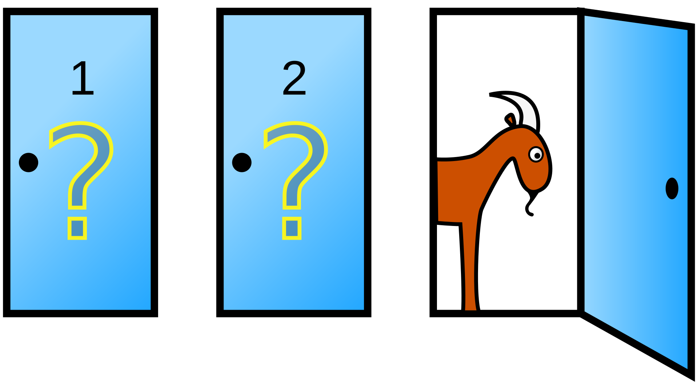

# NumPy Vectorization

Suppose a simulation contains one million values. A Python loop can process them one at a time, but NumPy can express the same work as an operation on the complete array. This style is called vectorization. It often produces shorter, clearer, and faster numerical code.

```{python}
import numpy as np
```

---

## Vectorization (Review)

**Vectorization** is the process of applying operations to entire arrays at once, rather than using loops to operate on individual elements. NumPy makes this easy by allowing us to perform element-wise operations on entire arrays, which is much faster than traditional loops.

We have been applying vectorization during our past classes already.

::: {.callout-note}
## Exercise: Add two arrays element-wise

How would you reproduce the following behavior without using an explicit loop?

```{python}
# Without Vectorization (Using loops)
a = np.array([1, 2, 3])
b = np.array([4, 5, 6])
result = np.zeros(3)  # Initializes 0 as floats = 0.0

for i in range(3):
  result[i] = a[i] + b[i]

print(result)
```
:::

::: {.callout-tip collapse="true"}
## Solution

```{python}
# With Vectorization
a = np.array([1, 2, 3])
b = np.array([4, 5, 6])

result = a + b

print(result)
```
:::

### Broadcasting Functions

When we define a function, sometimes it is able to be applied to the whole array directly, thanks to **NumPy's inherent broadcasting** capabilities. This allows NumPy to automatically apply the function element-wise to each element in the array without needing loops.

::: {.callout-note}
## Exercise: Vectorize a Polynomial

The code below defines the function $f(x) = x^2+2x+1$ and applies it to each element of the array `[1, 2, 3, 4, 5]` with a loop. Rewrite it without the loop.

```python
def f(x):
  return x**2 + 2*x + 1

# Array to apply the function to
arr = np.array([1, 2, 3, 4, 5])

# Initialize an empty result array
result = np.zeros(arr.shape)

# Apply the function to each element using a loop
for i in range(len(arr)):
  result[i] = f(arr[i])

print(result)
```
:::

::: {.callout-tip collapse="true"}
## Solution

How can we vectorize the function? We do not need to do anything special because the arithmetic inside the function can be applied to a NumPy array as is!

```{python}
arr = np.array([1, 2, 3, 4, 5])
result = arr**2 + 2*arr + 1
print(result)
```

We could have also vectorized the function itself, just like this:

```{python}
def f(x):
  return x**2 + 2*x + 1

# Array to apply the function to
arr = np.array([1, 2, 3, 4, 5])

# Apply the function directly to the array using vectorization
result = f(arr)

print(result)
```

:::

But what happens when a function has an `if`? An `if` needs a single Boolean, not an array of them, so the function cannot take a whole array (we will see why in [Masking: Avoiding Loops](masking_loops.qmd)). Some other functions cannot broadcast for the same reason. This happens, for instance, when using conditions inside the function that rely on scalar comparisons (like `if` statements), which are not inherently compatible with array inputs. In these cases, NumPy cannot apply the function to the entire array at once because the function was designed to handle only one value at a time.

For convenience, `np.vectorize()` can adapt a scalar function so it accepts arrays. Despite its name, it does not provide the main performance benefit of true NumPy vectorization; it still calls the Python function element by element. When possible, prefer array expressions, masks, or `np.where()` (see [Masking: Avoiding Loops](masking_loops.qmd)).

:::{.callout-note}
## Exercise: Safe Division with `np.vectorize()`

You are given two NumPy arrays, `numerators` and `denominators`. Your task is to write a function that performs element-wise division between the arrays, but handle cases where the denominator is zero. If the denominator is zero, return $10^{10}$, instead of causing an error.
:::

:::{.callout-tip collapse="true"}
## Solution

```{python}
def safe_division(numerator, denominator):
  if denominator == 0:
    return 1e10
  else:
    return numerator / denominator

# Vectorize the safe_division
fun = np.vectorize(safe_division)

numerators = np.array([1, 2, 3])
denominators = np.array([0, 1, 2])

result = fun(numerators, denominators)

print(result)
```

And here is a more efficient solution that does not use `np.vectorize()`:

```{python}
numerators = np.array([1, 2, 3])
denominators = np.array([0, 1, 2])

# We initialize the result array with 1e10 for all elements
result = np.full(numerators.shape, 1e10, dtype=float)

# Next, we create a boolean mask to identify the elements where the denominator is not zero
nonzero = denominators != 0

# Apply the division only to those elements where the denominator is not zero
result[nonzero] = numerators[nonzero] / denominators[nonzero]

print(result)
```
:::

---

## Recognizing a Loop That Can Disappear

A loop is a pattern. Once you recognize it, the replacement is almost always one line.

| The loop... | The replacement |
|---|---|
| works on each element on its own | arithmetic on the array |
| has an `if` inside | a mask, or `np.where()` (next page: [Masking: Avoiding Loops](masking_loops.qmd)) |
| accumulates (sum, count, running total) | `.sum()`, `.mean()`, `.cumsum()` with an `axis` |
| is a `while` that searches | `np.argmax()` on a Boolean array |
| calls a function that fails on arrays | a mask, or `np.vectorize()` |
| is nested (every row with every column) | broadcasting |

### A Loop That Accumulates: Reductions and `axis`

A loop with `total += ...` or `count += 1` is a reduction.

```{python}
prices = np.array([2.5, 4.0, 1.2, 10.0])
quantities = np.array([4, 1, 10, 2])

# Total of a shopping cart
print((prices * quantities).sum())

# How many scores are at least 50? A Boolean array sums as 0s and 1s
scores = np.array([38, 47, 62, 95, 99, 71, 44])
print((scores >= 50).sum())

# What fraction of them? The mean of a Boolean array
print((scores >= 50).mean())

# The running total
steps = np.array([3, 1, 4, 1, 5, 9, 2, 6])
print(np.cumsum(steps))
```

With a 2D array, `axis` chooses the dimension that disappears: `axis=0` goes down the rows (one result per column), `axis=1` goes across the columns (one result per row).

```{python}
grades = np.array([[60, 70, 80], [40, 90, 50], [100, 30, 70], [55, 65, 75]])

print(grades.mean(axis=1))  # average of every student
print(grades.mean(axis=0))  # average of every exam
```

::: {.callout-note}
## Exercise: The Best Day

`sales` has the sales of 4 weeks (rows) over 7 days (columns, Monday to Sunday). Find the total of every week, the total of every weekday, and which weekday sells the most.

```python
sales = np.array([[5, 3, 4, 6, 9, 12, 2],
                  [4, 2, 5, 7, 8, 11, 3],
                  [6, 3, 3, 5, 10, 13, 1],
                  [5, 4, 4, 6, 9, 10, 2]])
```
:::

::: {.callout-tip collapse="true"}
## Solution

```{python}
sales = np.array([[5, 3, 4, 6, 9, 12, 2],
                  [4, 2, 5, 7, 8, 11, 3],
                  [6, 3, 3, 5, 10, 13, 1],
                  [5, 4, 4, 6, 9, 10, 2]])

print(sales.sum(axis=1))  # one total per week (row)

weekday_totals = sales.sum(axis=0)  # one total per weekday (column)
print(weekday_totals)

print(weekday_totals.argmax())  # index 5: Saturday
```
:::

### A `while` That Searches: `np.argmax()`

Add the `steps` one by one until the total reaches 20. How many steps does it take?

```{python}
steps = np.array([3, 1, 4, 1, 5, 9, 2, 6])

# With a while loop
total = 0
i = 0
while total < 20:
    total += steps[i]
    i += 1
print(i)

# Vectorized: the running total, a Boolean array, and the first True
reached = np.cumsum(steps) >= 20
print(np.argmax(reached) + 1)
```

`np.argmax()` on a Boolean array returns the index of the first `True`. The index is the number of steps minus one, hence the `+ 1`.

::: {.callout-warning}
If there is **no** `True`, `np.argmax()` returns `0`, as if the first element were the answer. Check with `.any()` first.
:::

```{python}
reached = np.cumsum(steps) >= 100

if reached.any():
    print(np.argmax(reached) + 1)
else:
    print("The total never reaches 100")
```

Not every `while` becomes a one-liner. When step $i$ needs the result of step $i-1$ in a way that no `cumsum` or `cumprod` can express, the loop stays.

::: {.callout-note}
## Exercise: The First Negative Balance

`changes` holds the monthly changes of a bank account that starts at `0`. In which month does the balance first go below `0`? If it never does, print a message.

```python
changes = np.array([200, -150, 100, -250, 300])
```
:::

::: {.callout-tip collapse="true"}
## Solution

```{python}
changes = np.array([200, -150, 100, -250, 300])

below_zero = np.cumsum(changes) < 0

if below_zero.any():
    print("Month:", np.argmax(below_zero) + 1)
else:
    print("The balance never goes below 0")
```
:::

### A Nested Loop: Broadcasting

A loop inside a loop, where `i` walks the rows and `j` the columns, is a job for broadcasting. A column of shape `(n, 1)` against a row of shape `(1, n)` gives an `(n, n)` table.

```{python}
points = np.array([1, 4, 9, 16])

# With two loops
distances = np.zeros((len(points), len(points)))
for i in range(len(points)):
    for j in range(len(points)):
        distances[i, j] = abs(points[i] - points[j])

# With broadcasting
distances = np.abs(points[:, np.newaxis] - points[np.newaxis, :])
print(distances)

# A multiplication table
n = np.arange(1, 10)
print(n[:, np.newaxis] * n[np.newaxis, :])
```

---

## Extension: Monty Hall at Full Speed

::: {.callout-note}
This section is an extension. We do not cover it in class, but it is a good example of everything above on a real simulation.
:::

Remember the Monty Hall problem?

<p align="center">

</p>

[Take a look back at that session!](random_fancy_indexing.qmd)

```{python}
def monty_hall_init(n_games: int, verbose: bool=False) -> np.ndarray:
  # Initialize the matrix of doors, containing all goats
  x = np.zeros((n_games, 3)).astype(int)

  # Indexes of games can be generated through arange
  ls_id_game = np.arange(n_games)
  # Indexes of cars are chosen randomly between (0, 1, 2)
  ls_id_car = np.random.randint(0, 3, size=n_games)

  if verbose:
    print("List of index for games:", ls_id_game)
    print("List of index for cars: ", ls_id_car)

  # Assign cars through list indexing
  x[ls_id_game, ls_id_car] = 1

  return x
```

```{python}
# Start the game
game = monty_hall_init(10000)

# Get the number of games
n_games, n_doors = game.shape

# Initialize the number of times we find the car, as 0
sum_car = 0

# Loop through every game
for id_game in range(n_games):
  # Make a random choice between the doors (0, 1, 2)
  id_guest = np.random.randint(0, 3)

  # Where is the car? Check our array with car indexes
  id_car = np.argmax(game[id_game])

  # Choose the ID for the host
  id_host = (3 - id_guest - id_car) % 3
  if id_host == id_car:
    id_host += np.random.randint(1, 3)
    id_host %= 3

  # Apply the same logic to choose the door we swap to
  id_swap = (3 - id_guest - id_host) % 3

  # If we found the car, `sum_car` will increase by 1
  sum_car += game[id_game, id_swap]

print("Win probability:", sum_car / n_games)
```

The code we have above works fine, but it takes some time to compute one million simulations. We can speed up this process by being clever with NumPy.

<p align="center">

</p>

Our key goal: remove for loops and replace it with NumPy broadcasting.

---

### First Attempt: Keep the Initial Pick

```{python}
# Start the game
game = monty_hall_init(10)

# Get the number of games
n_games, n_doors = game.shape

# Indexes of games can be generated through arange
ls_id_game = np.arange(n_games)

# Indexes of the guest are chosen randomly between (0, 1, 2)
ls_id_guest = np.random.randint(0, 3, size=n_games)

# Resolve all games at once with list indexing
x_guest = game[ls_id_game, ls_id_guest]

print("Guest choices:         ", ls_id_guest[:10])
print("Result of their choice:", x_guest[:10])
print("Win probability:", np.mean(x_guest))
```

---

### Second Attempt: Switching Doors

In our loop implementation, the host intervention was handled with sets. This cannot be done in numpy so we must use some "coding hack".

```{python}
# Start the game
game = monty_hall_init(10000)

# Get the number of games
n_games, n_doors = game.shape

# Guest's initial choice
id_guest = np.random.randint(0, n_doors, size=n_games)

# Identify where the car is located
id_car = np.argmax(game, axis=1)

# Host's choice (one of the doors that the guest didn't choose and doesn't have the car)
# We can use (3 - id_guest - id_car) % 3 to find the door that is neither the guest's choice nor has the car
id_host = (3 - id_guest - id_car) % 3
# Adjust cases where guest's choice and car are the same
mask_same = id_guest == id_car
id_host[mask_same] += np.random.randint(1, 3, mask_same.sum())
id_host[mask_same] %= 3

# Guest's swap choice (the remaining door)
# Since there are 3 doors (0, 1, 2), the swapped door is (3 - id_guest - id_host) % 3
id_swap = (3 - id_guest - id_host) % 3

# Calculate wins
sum_car = np.sum(game[np.arange(n_games), id_swap])

print("Win probability:", sum_car / n_games)
```

---

## Summary and Reflection

- Vectorization replaces element-by-element Python loops with array operations.
- Broadcasting lets compatible shapes participate in one expression.
- A loop that accumulates becomes a reduction (`.sum()`, `.mean()`, `.cumsum()`) with an `axis`.
- A `while` that searches becomes `np.argmax()` on a Boolean array.
- A nested loop becomes broadcasting.
- `np.vectorize()` changes an interface but usually does not make a scalar Python function faster.

Choose one loop from this lesson and explain which array operation replaces each part of the loop.

---

# Next

[Masking: Avoiding Loops](masking_loops.qmd){.btn .btn-primary}
