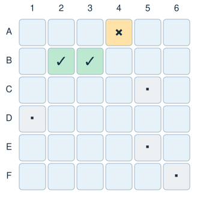

Build the logic of a Battleship game. Three ships hide on a 6 × 6 board, and players fire at cells until the whole fleet is sunk. You will write the functions that record shots and decide whether each one is a miss, a hit, or a sinking blow. A supplied interface then uses your functions to let two players compete in Jupyter or Google Colab.

Main concepts: tuples, lists, sets, nested dictionaries, copying, and functions that work together.

<p align="center">

</p>

## The data

The fleet has three ships:

1. Submarine: 2 cells.
2. Destroyer: 3 cells.
3. Cruiser: 3 cells.

Each ship occupies consecutive cells in a horizontal or vertical line. Ships cannot overlap, but they may touch.

Represent each position as a tuple `(row, col)`. Both indices start at 0, so on a 6 × 6 board they run from 0 to 5. The interface labels rows `A` to `F` and columns `1` to `6`, so position `(1, 2)` appears as `B3`.

The fleet is a dictionary that maps each ship name to a list of its positions:

```{python}
board_size = 6

ships = {
    "Submarine": [(1, 1), (1, 2)],
    "Destroyer": [(3, 2), (4, 2), (5, 2)],
    "Cruiser": [(0, 3), (0, 4), (0, 5)]
}
```

A complete game is a dictionary with three keys:

- `"size"`: the number of rows and columns on the board.
- `"ships"`: the fleet dictionary.
- `"shots"`: a set with the positions that have already been targeted.

```python
{
    "size": 6,
    "ships": {
        "Submarine": [(1, 1), (1, 2)],
        "Destroyer": [(3, 2), (4, 2), (5, 2)],
        "Cruiser": [(0, 3), (0, 4), (0, 5)]
    },
    "shots": set()
}
```

Ship positions never change during a game; only the set of shots grows. A set is a natural choice here: checking membership is fast, and the same cell cannot be stored twice.

Use the exact function names, parameters, and return values described below, so the interface can call them. Your functions must return their results; they should not ask for input or print messages.

You can assume that `size` is a positive integer, the starting fleet is valid and nonempty, and every position passed to your functions is a tuple of two integers.

## Step 1: Create a game

Create `create_game(size, ships)`.

1. Build a new fleet dictionary, copying each ship's list of positions.
2. Return a game dictionary with the keys `"size"`, `"ships"`, and `"shots"`.
3. Store the supplied size, the copied fleet, and a new empty set of shots.

Each game must own its fleet lists and its set of shots, so starting a second game never changes the first. Review the [Mutability](mutability.qmd) lesson if you are unsure why `game["ships"] = ships` is not enough.

```python
game = create_game(board_size, ships)
```

## Step 2: Check a position

Create `is_valid_position(game, position)`.

Return `True` if both indices are at least 0 and smaller than the board size stored in the game. Otherwise, return `False`.

```python
is_valid_position(game, (0, 5))   # True
is_valid_position(game, (6, 2))   # False
is_valid_position(game, (-1, 3))  # False
```

Negative indices are valid in Python lists, but not on our board.

## Step 3: Check previous shots

Create `was_targeted(game, position)`.

Return `True` if the position is already in the game's set of shots, or `False` otherwise. This function only checks; it must not add the position to the set.

```python
was_targeted(game, (1, 1))  # False at the start of a game.
```

## Step 4: Find a ship

Create `ship_at(game, position)`.

1. Loop over each ship name and its list of positions.
2. If the position belongs to that ship, return its name.
3. If no ship occupies the position, return `None`.

```python
ship_at(game, (1, 2))  # "Submarine"
ship_at(game, (2, 5))  # None
```

## Step 5: Check whether a ship is sunk

Create `is_sunk(game, ship_name)`. You can assume that the ship name exists.

Return `True` only if every position of the ship has been targeted. Return `False` as soon as you find one that has not.

Reuse `was_targeted()` for each position. A single hit does not sink a ship with several cells: the Submarine is sunk only after both `(1, 1)` and `(1, 2)` have been targeted.

## Step 6: List the remaining ships

Create `remaining_ships(game)`.

Return a list with the names of the ships that are not sunk, in the order in which they appear in the fleet dictionary. Use `is_sunk()` to check each ship.

```python
remaining_ships(game)  # ["Destroyer", "Cruiser"] after sinking only the Submarine.
```

## Step 7: Fire a shot

Create `fire(game, position)`. This is the only function that changes the game.

1. If the position is outside the board, return `"invalid"`.
2. If it has already been targeted, return `"repeated"`.
3. Add the position to the set of shots.
4. If no ship occupies the position, return `"miss"`.
5. If the ship is now sunk, return `"sunk"`.
6. Otherwise, return `"hit"`.

Invalid and repeated shots must leave the game unchanged. Record a valid new shot before checking whether it sinks a ship; otherwise, the last hit on a ship will never return `"sunk"`.

Starting from a fresh game with the supplied fleet:

```python
fire(game, (1, 1))  # "hit"
fire(game, (1, 1))  # "repeated"
fire(game, (1, 2))  # "sunk"
fire(game, (2, 5))  # "miss"
fire(game, (6, 0))  # "invalid"
```

## Step 8: Check for victory

Create `has_won(game)`.

Return `True` if no ships remain afloat, or `False` otherwise. Use `remaining_ships()`. Like the other checking functions, `has_won()` must not change the game.

```python
has_won(game)  # False at the start of a game.
```

## Step 9: Test your functions

Create a fresh game before each group of tests so earlier shots do not affect later results.

Check that:

- A new game has the correct size and fleet, and an empty set of shots.
- Two games created from the same `ships` dictionary do not share fleet lists or sets of shots. Fire at one and confirm the other is unchanged.
- Positions on the edges of the board are valid; negative indices and indices equal to the board size are not.
- A position counts as targeted only after `fire()` records it.
- `ship_at()` returns the correct name for a ship cell and `None` for water.
- A partially hit ship is not sunk, and the list of remaining ships excludes sunk ships.
- Repeated and invalid shots do not change the number of recorded shots.
- `has_won()` returns `False` while any ship is afloat and `True` after the last one sinks.

Write each test so you can compare the expected and actual results, for example with `print()` or `assert`.

## Step 10: Play the game

The interface below is already implemented. **You do not need to write or modify it.** It calls your functions and uses `ipywidgets` to draw the boards. It works in Google Colab and in Jupyter; locally, you may need to install `ipywidgets` first.

1. Run the data cell and your cells for Steps 1–8.
2. Copy the interface code below into a new cell and run it.
3. In another cell, call `play_battleship()`.

Two players take turns on the same device. Each player has a fleet in random positions, using the same ship lengths as the example fleet. On your turn, press **Ready**, click a cell on your opponent's board to fire, and then hide the boards before passing the device. The first player to sink the entire enemy fleet wins. Click **New game** to start again.

If you correct a function, rerun its cell and start a new game. If the interface reports an error, check your function names, parameters, and return values.

```{python}
#| eval: false
#| code-fold: true
#| code-summary: "Interface code (supplied)"
def play_battleship():
    import random
    import traceback
    from html import escape
    import ipywidgets as widgets
    from IPython.display import display

    required = [
        "create_game", "is_valid_position", "was_targeted", "ship_at",
        "is_sunk", "remaining_ships", "fire", "has_won"
    ]
    missing = [
        name for name in required
        if not callable(globals().get(name))
    ]

    if missing:
        print("Complete and run these functions first: " + ", ".join(missing))
        return

    if "board_size" not in globals() or "ships" not in globals():
        print("Run the data cell first.")
        return

    try:
        from google.colab import output
    except ImportError:
        pass
    else:
        output.enable_custom_widget_manager()

    size = board_size
    players = ["Player 1", "Player 2"]
    games = []
    current = 0
    phase = "handover"
    own_buttons, target_buttons = {}, {}

    title = widgets.HTML("<h2>🚢 Battleship — Two players</h2>")
    message = widgets.HTML()
    scores = widgets.HTML()
    errors = widgets.Output()

    next_button = widgets.Button(
        button_style="primary",
        layout=widgets.Layout(width="230px")
    )
    restart = widgets.Button(description="New game", icon="refresh")

    def say(text):
        message.value = (
            '<div role="status" aria-live="polite">'
            + escape(text)
            + "</div>"
        )

    def make_fleet():
        for attempt in range(100):
            fleet, occupied = {}, set()

            for name, original_cells in ships.items():
                length = len(original_cells)
                options = []

                for row in range(size):
                    for column in range(size):
                        for dr, dc in ((0, 1), (1, 0)):
                            cells = [
                                (row + dr * i, column + dc * i)
                                for i in range(length)
                            ]

                            if (
                                all(
                                    0 <= r < size and 0 <= c < size
                                    for r, c in cells
                                )
                                and not occupied.intersection(cells)
                            ):
                                options.append(cells)

                if not options:
                    break

                fleet[name] = random.choice(options)
                occupied.update(fleet[name])
            else:
                return fleet

        raise ValueError("The fleet cannot be placed. Check the data cell.")

    def guarded(action, *args):
        nonlocal phase

        try:
            action(*args)
        except Exception:
            phase = "error"
            boards.layout.display = "none"
            next_button.layout.display = "none"
            scores.value = ""

            say(
                "Check your functions, rerun the corrected cells, "
                "then click New game."
            )

            with errors:
                traceback.print_exc()

    def draw_board(buttons, game, reveal=False):
        for position, button in buttons.items():
            label = f"{chr(65 + position[0])}{position[1] + 1}"
            name = ship_at(game, position)
            symbol, colour, detail = "", "#E6F1F8", "Untried"

            if was_targeted(game, position):
                if name is None:
                    symbol, colour, detail = "·", "#EDF0F3", "Miss"
                elif is_sunk(game, name):
                    symbol, colour, detail = "✓", "#BCE8D0", f"{name} sunk"
                else:
                    symbol, colour, detail = "×", "#FFE2A8", "Hit"

            elif reveal and name is not None:
                symbol, colour, detail = "■", "#BED5ED", name

            button.description = f"{label} {symbol}".strip()
            button.style.button_color = colour
            button.tooltip = f"{label}: {detail}"
            button.disabled = reveal or phase != "playing"

    def refresh():
        own = games[current]
        target = games[1 - current]

        draw_board(own_buttons, own, reveal=True)
        draw_board(target_buttons, target)

        scores.value = (
            f"<b>{players[current]}</b>"
            f" — Shots fired: {len(target['shots'])}"
            f"<br>Your ships afloat: {len(remaining_ships(own))}"
            f" | Opponent's ships afloat: {len(remaining_ships(target))}"
        )

    def handover():
        boards.layout.display = "none"
        scores.value = ""

        # Remove private information before passing the device.
        for button in (
            list(own_buttons.values()) + list(target_buttons.values())
        ):
            button.description = ""
            button.tooltip = ""
            button.style.button_color = "#E6F1F8"
            button.disabled = True

        say(
            f"Pass the device to {players[current]}. "
            "Press Ready when the other player cannot see the screen."
        )

        next_button.description = f"Ready — {players[current]}"
        next_button.layout.display = ""

    def shoot(position):
        nonlocal phase

        if phase != "playing":
            return

        # Each game stores its owner's fleet and the shots RECEIVED.
        target = games[1 - current]
        result = fire(target, position)

        if result in ("invalid", "repeated"):
            say(
                "Choose an untried cell inside the board. "
                "It is still your turn."
            )
            return

        if result not in ("miss", "hit", "sunk"):
            raise ValueError(
                'fire() must return "invalid", "repeated", '
                '"miss", "hit", or "sunk".'
            )

        label = f"{chr(65 + position[0])}{position[1] + 1}"

        if has_won(target):
            phase = "finished"
            say(
                f"{players[current]} wins! "
                "The entire enemy fleet is sunk."
            )
            next_button.layout.display = "none"
        else:
            phase = "after_shot"
            say(
                f"{players[current]} — {label}: {result.upper()}. "
                "Your turn is over."
            )
            next_button.description = "Hide boards & pass device"
            next_button.layout.display = ""

        refresh()

    def advance():
        nonlocal current, phase

        if phase == "after_shot":
            current = 1 - current
            phase = "handover"
            handover()

        elif phase == "handover":
            phase = "playing"
            refresh()
            boards.layout.display = "flex"
            next_button.layout.display = "none"

            say(
                f"{players[current]}: "
                "fire one shot on the opponent's board."
            )

    def make_board(buttons, clickable):
        rows = []

        for row in range(size):
            row_buttons = []

            for column in range(size):
                position = (row, column)

                button = widgets.Button(
                    layout=widgets.Layout(
                        width="54px",
                        min_width="54px",
                        height="46px"
                    ),
                    style={
                        "font_weight": "600",
                        "text_color": "#142C43"
                    }
                )

                if clickable:
                    button.on_click(
                        lambda clicked, pos=position: guarded(shoot, pos)
                    )

                buttons[position] = button
                row_buttons.append(button)

            rows.append(
                widgets.HBox(
                    row_buttons,
                    layout=widgets.Layout(gap="4px")
                )
            )

        return widgets.VBox(
            rows,
            layout=widgets.Layout(gap="4px", overflow="auto")
        )

    boards = widgets.HBox(
        [
            widgets.VBox([
                widgets.HTML("<b>Your fleet</b>"),
                make_board(own_buttons, False)
            ]),
            widgets.VBox([
                widgets.HTML("<b>Opponent's waters — click to fire</b>"),
                make_board(target_buttons, True)
            ])
        ],
        layout=widgets.Layout(
            gap="24px",
            flex_flow="row wrap",
            display="none"
        )
    )

    def new_game():
        nonlocal games, current, phase

        games = []
        errors.clear_output()

        for player in players:
            game = create_game(size, make_fleet())

            if (
                not isinstance(game, dict)
                or not {"size", "ships", "shots"} <= game.keys()
            ):
                raise TypeError(
                    'create_game() must return a dictionary '
                    'with "size", "ships", and "shots".'
                )

            if not isinstance(game["shots"], set) or game["shots"]:
                raise TypeError(
                    "A new game must contain an empty set of shots."
                )

            games.append(game)

        current, phase = 0, "handover"
        handover()

    next_button.on_click(lambda clicked: guarded(advance))
    restart.on_click(lambda clicked: guarded(new_game))

    display(
        widgets.VBox(
            [
                title,
                message,
                scores,
                boards,
                widgets.HTML(
                    "■ Your ship &nbsp; · Miss &nbsp; "
                    "× Hit &nbsp; ✓ Sunk"
                ),
                next_button,
                restart,
                errors
            ],
            layout=widgets.Layout(gap="12px")
        )
    )

    guarded(new_game)
```

```python
play_battleship()
```

## Stretch goals (optional)

- **Accuracy:** return the percentage of recorded shots that hit a ship.
- **Shot history:** store each new shot and its result as a tuple in a list, preserving their order.
- **Limited ammunition:** give each player a maximum number of shots and detect when they run out.
- **Manual placement:** let a player place ships, rejecting overlaps and positions outside the board.

Extensions that change the rules may also require changes to the interface. Document what you changed and add tests for it.

## Before you submit

Upload your completed notebook to the **Side Projects** section on Blackboard **before the final exam**.

Include your functions, your tests with saved outputs, and a short explanation of why `create_game()` must copy the ship lists. Follow the notebook and AI-use guidance on the [Side Projects page](side_projects.qmd).
