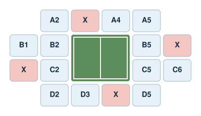

Build a small booking system for the Olympic Games. Fans choose one of five events, inspect the venue's seating plan, and book or cancel a seat. Every booking must reserve the right seat, and every cancellation must free it again so another fan can take it.

Main concepts: tuples, nested lists, string formatting, updating lists in place, and a menu-driven program.

<p align="center">

</p>

## The data

Each event is a tuple `(sport, venue, starting_time, price)`. An event's position in `events` is its event index.

```{python}
events = [
    ("Athletics", "Olympic Stadium", "10:00", 35.00),
    ("Swimming", "Aquatics Centre", "12:00", 30.00),
    ("Basketball", "Indoor Arena", "16:00", 40.00),
    ("Tennis", "Central Court", "18:00", 45.00),
    ("Gymnastics", "Gymnastics Arena", "20:00", 38.00)
]
```

Each venue has its own seating plan: a list of rows, where each row is a list of strings.

- A seat code such as `"A3"` is an available seat.
- `"X"` is an occupied seat.
- `"--"` is an empty space with no seat. It must never be booked.

```{python}
athletics_seats = [
    ["A1", "A2", "A3", "A4", "A5", "A6", "A7", "A8"],
    ["B1", "B2", "B3", "B4", "B5", "B6", "B7", "B8"],
    ["C1", "C2", "C3", "C4", "C5", "C6", "C7", "C8"],
    ["D1", "D2", "D3", "D4", "D5", "D6", "D7", "D8"]
]

swimming_seats = [
    ["A1", "A2", "A3", "A4", "A5", "A6"],
    ["--", "--", "--", "--", "--", "--"],
    ["B1", "B2", "B3", "B4", "B5", "B6"]
]

basketball_seats = [
    ["A1", "A2", "A3", "A4", "A5", "A6"],
    ["B1", "B2", "--", "--", "B5", "B6"],
    ["C1", "C2", "--", "--", "C5", "C6"],
    ["D1", "D2", "D3", "D4", "D5", "D6"]
]

tennis_seats = [
    ["--", "A2", "A3", "A4", "A5", "--"],
    ["B1", "B2", "--", "--", "B5", "B6"],
    ["C1", "C2", "--", "--", "C5", "C6"],
    ["--", "D2", "D3", "D4", "D5", "--"]
]

gymnastics_seats = [
    ["A1", "A2", "A3", "A4", "A5"],
    ["B1", "B2", "B3", "B4", "B5"],
    ["C1", "C2", "C3", "C4", "C5"],
    ["D1", "D2", "D3", "D4", "D5"]
]

# seat_plans[i] is the seating plan of events[i].
seat_plans = [
    athletics_seats,
    swimming_seats,
    basketball_seats,
    tennis_seats,
    gymnastics_seats
]

bookings = []
```

`bookings` stores one tuple per successful booking:

```text
(customer_name, event_index, seat_code, row, col, price)
```

For example, `("Marta", 2, "D4", 3, 3, 40.00)` is Marta's booking of seat D4 at the basketball game.

The seating plans and `bookings` are lists, so your functions can change them in place without the `global` keyword. Review the [Python Scope](../python-fundamentals/scope.qmd) and [Mutability](mutability.qmd) lessons if this is unclear.

## Step 1: List the events

Create `show_events(events)`. Return a single string with one numbered line per event, showing its sport, venue, time, and price.

```text
1. Athletics  | Olympic Stadium  | 10:00 | €35.00
2. Swimming   | Aquatics Centre  | 12:00 | €30.00
...
```

Use `enumerate()` to number the events, and f-strings to format each line. Join the lines with `"\n"`. Aligning the columns is optional; the format specifier `{sport:<10}` pads a string to ten characters.

Return the string rather than printing it, so the menu in Step 7 decides when to print.

## Step 2: Display a seating plan

Create `show_seating_plan(seat_plan)`. Return a single string with one line per row, separating the seats with spaces.

```text
A1 A2 A3 A4 A5 A6
B1 B2 -- -- B5 B6
C1 C2 -- -- C5 C6
D1 D2 D3 D4 D5 D6
```

## Step 3: Find a seat

Create `find_seat(seat_plan, seat_code)`.

1. Convert the seat code to uppercase, so `"a3"` and `"A3"` are treated equally.
2. Loop over the rows and seats, keeping track of their indices.
3. If the seat is found, return `(row, col)`.
4. Otherwise, return `(-1, -1)`.

```python
find_seat(athletics_seats, "A3")  # (0, 2)
find_seat(athletics_seats, "c8")  # (2, 7)
find_seat(athletics_seats, "Z9")  # (-1, -1)
```

An occupied seat shows `"X"`, so its original code is no longer in the plan: `find_seat()` will not find a seat that has already been booked. This is why each booking stores the seat's indices.

## Step 4: Book a seat

Create `book_seat(customer_name, event_index, seat_code)`. It uses `events`, `seat_plans`, and `bookings` from the data cell.

1. If `event_index` is not a valid index of `events`, return `False`.
2. Find the seat in the event's seating plan. If it is not found, return `False`.
3. Replace the seat code with `"X"` in the seating plan.
4. Append the booking tuple to `bookings`, using the uppercase seat code and the event's price.
5. Return `True`.

Be careful: `"X"` and `"--"` appear in the seating plans, so `find_seat()` can find them. Booking either must return `False` and leave everything unchanged.

```python
book_seat("Marta", 2, "d4")  # True: seat D4 at the basketball game.
book_seat("Marta", 2, "D4")  # False: already booked.
book_seat("Marta", 2, "C4")  # False: that position is "--".
book_seat("Marta", 7, "A1")  # False: there is no event 7.
```

Negative numbers are valid list indices in Python, but not valid event indices here.

## Step 5: Cancel a booking

Create `cancel_booking(customer_name, event_index, seat_code)`.

1. Find the booking with this customer name, event index, and seat code. Treat the seat code case-insensitively, as in Step 3.
2. Restore the seat code in the event's seating plan, using the stored row and column.
3. Remove the booking tuple from `bookings`.
4. Return `True`, or `False` if no matching booking exists.

Removing items from a list while looping over it can skip elements. Once you have removed the matching booking, return immediately.

After a cancellation, the seat must be available again: `book_seat()` should accept it.

## Step 6: Summarize the bookings

Create two helper functions for the menu:

- `customer_bookings(customer_name)` returns the list of booking tuples that belong to that customer.
- `total_revenue()` returns the sum of the prices of all bookings.

## Step 7: Build the menu

Connect your functions in a program that repeatedly shows this menu:

```text
===== OLYMPIC GAMES BOOKING SYSTEM =====

1. Show Olympic events
2. View a seating plan
3. Book a seat
4. Cancel a booking
5. Find a customer's bookings
6. Show all bookings
7. Show total revenue
8. Exit
```

1. Show the menu and ask the user for a number from 1 to 8 with `input()`.
2. If the input is not one of these numbers, print an error message and ask again. Letters and empty input must not crash the program.
3. Run the chosen operation, asking for any extra details it needs, such as the customer's name, the event number, or the seat code.
4. Show the menu again after each operation.
5. When the user chooses 8, print a goodbye message and stop.

Users see events numbered from 1, but your functions use indices from 0. Convert between them in the menu, not inside your functions.

Use a `while` loop to keep the program running. Reuse the functions from the previous steps; the menu should mostly read input, call functions, and print their results.

## Step 8: Test your program

Test your functions directly before testing the menu. Run the data cell again before each group of tests, so earlier bookings do not affect later results.

Check that:

- Each event displays the correct seating layout for its venue.
- `find_seat()` returns the right indices, ignores case, and returns `(-1, -1)` for a nonexistent seat.
- A valid booking changes the correct seat to `"X"` and stores the correct tuple.
- Booking the same seat twice, a `"--"` position, `"X"`, a nonexistent seat, or an invalid event index returns `False` and changes nothing.
- Booking `"A1"` for Athletics does not change `"A1"` in any other venue.
- A cancellation restores the original seat code, removes the booking, and lets the seat be booked again.
- Cancelling a nonexistent booking returns `False` without crashing.
- `customer_bookings()` and `total_revenue()` return the expected results after several bookings and cancellations.
- In the menu, every option runs the correct operation, invalid input is handled safely, and only option 8 ends the program.

## Stretch goals (optional)

- **Available seats:** show how many seats remain available for each event.
- **Row-based pricing:** charge different prices depending on the row of the seat.
- **Discounts:** apply a discount when a customer books tickets for three or more events.
- **Waiting list:** let customers join a waiting list when an event is full, and give them the seat when someone cancels.

Document any extension you implement and add tests for it.

## Before you submit

Upload your completed notebook to the **Side Projects** section on Blackboard **before the final exam**.

Include your functions, your tests with saved outputs, and an example session of the menu. Explain why each booking stores the row and column of its seat. Follow the notebook and AI-use guidance on the [Side Projects page](side_projects.qmd).
